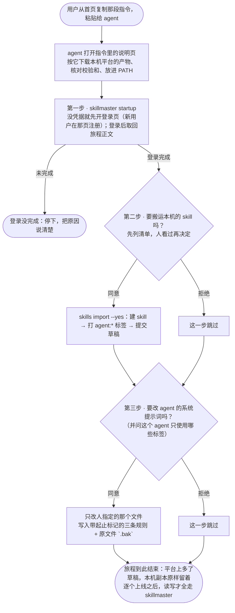

# v17-cli-startup · PRD

## 用户与场景

**谁**：已经在用某个 agent 的人——Claude Code、WorkBuddy，或其他遵循 Agent Skills 约定的客户端。本机有一个技能目录（Claude Code 是 `~/.claude/skills`），里面有若干 `SKILL.md` 目录树，数量从 1 个到几百个文件不等。

**他要什么**：把这些 skill 集中托管，让它们跨机器可用、能被 agent 按需拉取而不是全量装在本机；同时以后改 skill 也走平台，而不是在本机改完再手工同步。

**现在的替代做法**：手工 `skillmaster skill create` + `skill write` + `skill submit` 一个目录一个目录地搬。33 个 skill 就是 33 遍，没人会这么做；于是存量 skill 永远留在本机，产品对老用户没有入口。

**这一版补的**：从"本机一堆 skill"走到"平台上托管、agent 按需取用"的那座桥。**桥本身是一份托管在服务端的正文**——`skillmaster startup` 取回它并打印，agent 照做。它走 `/gateway/{file}` 这条匿名的文件路由（与上一版的网关 skill 同一条通道），但**它不是 skill**：本机不装任何 skill（[ADR 0089](../../decisions/0089-no-local-skills.md)）。

## 用户旅程

**怎么读这张图**：圆角框是起点与终点，方框是 CLI 或 agent 执行的动作，菱形是**判断点**。两个菱形**都必须问人**（搬不搬、改不改提示词）；例外只有登录，它是后续每一步的前提，不完成就停下。

| 步 | 谁执行 | 必须问什么 | 拒绝会怎样 | 验收 |
|---|---|---|---|---|
| 安装 | agent 按正文 | 不问（用户粘贴那段话就是同意） | — | 1–3 |
| ① 登录 | CLI + 浏览器 | 不问（第一步就是登录，没有"不登录"的分支） | 没完成就停下，不假装成功 | 4–5 |
| ② 搬运 | CLI | **先列清单，带 `--yes` 才写服务器**；推荐搬 | 跳过，旅程继续 | 6–14 |
| ③ 系统提示词 | agent | **改之前问**；推荐改 | 跳过，旅程继续 | 15–18 |

**三条容易被忽略的分支，图里专门画了**：

- **② 的同意由 `--yes` 表达，不由 stdin 表达**。agent 读不到终端输入，让它在"确认处回答否"是一道它跨不过去的门。所以照仓库既有约定（`version discard`、`skill join` 同款）：**不带 `--yes` 时只打印将被创建的清单与它自己会跑的那条完整命令，然后退出**；agent 把清单转述给人，人同意后由 agent 补上 `--yes` 重跑。
- **② 不逐个开浏览器**。`skill submit` 每成功一次就打开一次标签页（`main.go:2714` 的既有行为），33 个 skill 就是 33 个标签。`import` 在整批跑完之后**只打印一份合并的审批地址清单**，不打开任何标签。
- **每一步的拒绝只跳过这一步**，不中止旅程。只有登录没完成会停下——那是唯一一个后续所有步骤都依赖的前置。

## 各 agent 的技能目录

**Agent Skills 规范本身不规定目录位置**（[agentskills.io/specification](https://agentskills.io/specification) 只定义 `SKILL.md` 与其同目录的子结构）。位置由客户端各自决定，但已经收敛出一个跨客户端的公共位置 `~/.agents/skills/`——今天的主流客户端大多读它，只是优先级低于自己的目录。

**证据强度逐行标注**，因为其中只有一部分是官方文档：「官方」= 客户端自己的文档或源码；「本机」= 这台机器上实测存在；「第三方」= 安装器与生态整理，官方文档未直接确认。

| 客户端 | 用户级目录 | 项目级目录 | 依据 |
|---|---|---|---|
| **通用位置（规范推荐）** | `~/.agents/skills/` | `.agents/skills/` | [agentskills.io](https://agentskills.io/skill.md)；下表有 14 个客户端读它 |
| Claude Code | `~/.claude/skills/` | `.claude/skills/` | **本机**（33 个 skill） |
| Codex CLI | `~/.agents/skills/` 为主；`~/.codex/skills/` 是旧位置、仍会被读取 | `.agents/skills/` | **官方** loader；本机 `~/.codex/skills` 只剩 `.system` |
| Cursor | `~/.cursor/skills/` | `.cursor/skills/` | **官方**；兼容读 `~/.agents`、`~/.claude`、`~/.codex` |
| Gemini CLI | `~/.gemini/skills/` | `.gemini/skills/` | **官方**；`~/.gemini/skills` 与 `~/.agents/skills` 互为别名 |
| GitHub Copilot CLI | `~/.copilot/skills/` | `.github/skills/` | **官方**；兼容读 `~/.agents`、`~/.claude` |
| opencode | `~/.config/opencode/skills/` | `.opencode/skills/` | **官方**；兼容读 `~/.claude`、`~/.agents` |
| Windsurf | `~/.codeium/windsurf/skills/` | `.windsurf/skills/` | **官方**；读 `~/.agents`（开启 Claude 兼容时也读 `~/.claude`） |
| Amp | `~/.config/amp/skills/` | `.agents/skills/` | **官方**；另有更高优先级的 `~/.config/agents/skills`、`~/.agents/skills`，也读 `~/.claude` |
| Zed | `~/.agents/skills/` | `.agents/skills/` | **官方**：没有自有目录，只用通用位置 |
| Warp | `~/.agents/skills/` | `.agents/skills/` | **第三方**：无自有目录 |
| Kiro | `~/.kiro/skills/` | `.kiro/skills/` | **官方**配置同步 + 第三方安装器 |
| Cline | `~/.cline/skills/` | `.cline/skills/` | **第三方**；部分工具写 `~/.agents/skills` |
| Roo Code | `~/.roo/skills/` | `.roo/skills/` | **第三方** |
| Qwen Code | `~/.qwen/skills/` | `.qwen/skills/` | **官方**仓库；也读 `.agents/skills` |
| OpenHands | `~/.openhands/skills/` | `.agents/skills/` | **官方**；新版也读 `~/.agents/skills` |
| Factory Droid | `~/.factory/skills/` | `.factory/skills/` | **第三方**安装器；也读 `.agents/skills` |
| WorkBuddy | `~/.workbuddy/skills/` | `.workbuddy/skills/` | **第三方**（[腾讯云文档](https://cloud.tencent.cn/developer/article/2755078)） |
| Pi | `~/.agents/skills/` | `.agents/skills/` | **官方**项目文档 |
| DeepSeek Harness | `~/.dsh/skills/` | `.dsh/skills/` | **官方**；也读 `~/.agents/skills` |

**操作系统差异**：上表的 `~` 在 macOS / Linux 是 `$HOME`，在 Windows 是 `%USERPROFILE%`（即 `C:\Users\<名字>\`）。目录名与层级三端一致，**没有额外的平台分支**。管理员级位置（Linux 的 `/etc/codex/skills`、macOS 的 `/Library/Application Support/Windsurf/skills/`、Windows 的 `C:\ProgramData\Windsurf\skills\`）不属于用户数据，本版不碰。

**四个由这张表直接推出的结论**：

1. **`~/.agents/skills/` 扫一次就覆盖大半个生态**——Codex、Zed、Warp、Amp、Gemini CLI、Pi、DeepSeek Harness 以它为主，Cursor、Copilot CLI、opencode、Windsurf、OpenHands、Factory、Qwen Code 把它当兼容位置读，共 14 个。它是唯一一个"扫了不会白扫"的目录。
2. **自带目录的客户端各要一条路径**，但都只是一次目录存在性判断，代价可以忽略。本机只有三个目录存在（`.agents` 28 个、`.claude` 33 个、`.codex` 只有 `.system`），所以探测结果会因机器而异。
3. **同名的 skill 可能同时存在于多个位置**。本机实测：`~/.agents/skills` 28 个、`~/.claude/skills` 33 个，同名目录的 inode 不同——是两份独立拷贝，不是软链。因此搬运必须**按 skill 名去重**（规范要求目录名与 `SKILL.md` 的 `name` 一致），同名同内容合并成一条，同名不同内容必须停下来问。
4. **一个 skill 内部还可以再嵌 `SKILL.md`，那不是并列的另一个 skill**。本机实测：`~/.claude/skills/coding` 里有 10 个、`lark` 里 1 个——它们是那个 skill 自己的子结构（子技能、参考资料）。所以扫描**只认 `<目录>/<名字>/SKILL.md` 这一层**，不递归；并且**跳过以 `.` 开头的条目**——`~/.codex/skills/.system/` 里是客户端自带的 5 个 skill（imagegen、skill-creator 等），不是用户的东西。

### 搬进来时打什么标签

搬运时按**来源目录**给每个 skill 打一个个人标签，形如 `agent:<名字>`。

**标签记的是来源，不是兼容性。** `~/.claude/skills` 里的 skill 不是"只能给 Claude 用"——Codex、Cursor、Zed 读的都是同一份 `SKILL.md`。所以标签回答的是"这份东西原先在谁的目录里"，用来在平台上区分批量来源，而不是给 skill 划边界。

| 用户级目录 | 默认标签 |
|---|---|
| `~/.agents/skills/` | `agent:common` |
| `~/.claude/skills/` | `agent:claude` |
| `~/.codex/skills/`（旧位置） | `agent:codex` |
| `~/.cursor/skills/` | `agent:cursor` |
| `~/.gemini/skills/` | `agent:gemini` |
| `~/.copilot/skills/` | `agent:copilot` |
| `~/.config/opencode/skills/` | `agent:opencode` |
| `~/.codeium/windsurf/skills/` | `agent:windsurf` |
| `~/.config/amp/skills/` | `agent:amp` |
| `~/.config/agents/skills/` | `agent:amp`（Amp 的更高优先级位置） |
| `~/.kiro/skills/` | `agent:kiro` |
| `~/.cline/skills/` | `agent:cline` |
| `~/.roo/skills/` | `agent:roo` |
| `~/.qwen/skills/` | `agent:qwen` |
| `~/.openhands/skills/` | `agent:openhands` |
| `~/.factory/skills/` | `agent:factory` |
| `~/.workbuddy/skills/` | `agent:workbuddy` |
| `~/.dsh/skills/` | `agent:dsh` |

三条规则：

- **表外的目录不打标签**。用户显式给一个表里没有的路径时，搬上去的 skill 没有 agent 标签——这张表就是名词表，不在表里就不造新词。
- **去重合并时标签取并集**。同一份内容同时出现在 `~/.agents/skills` 和 `~/.claude/skills` 时，合并成一条并同时带 `agent:common` 与 `agent:claude`：两处都是它待过的地方，抹掉任何一条都是丢信息。
- **`--tag` 可以覆盖**。给了就完全用给的那个（多个用逗号分隔），不再自动加；这样"这批是手工整理的"能盖掉来源。

## 范围

### 做

1. **二进制分发**：阿里云 OSS 托管，走 `https://dl.skillmasterai.com/` 这个自有域名，匿名可下载。**六个产物**——macOS / Linux / Windows 各两个架构——外加 `checksums.txt` 与两个安装脚本。**不放 GitHub Releases**：用户在国内，GitHub 的下载地址对他们不可用。

包清单、平台证据、检测规则与安装脚本的行为，**权威在 [`skillmaster-cli/RELEASE.md`](../../../skillmaster-cli/RELEASE.md)**——那是长期的发布规范，这里不复述。

本版要落的就是那张表本身：六个 64 位包（macOS / Linux / Windows × arm64 / amd64）、`checksums.txt`、`install.sh` 与 `install.ps1`，首次发布 `1.0.0`。32 位与 FreeBSD / ppc64le / s390x 不发。

**选包不靠模型判断**：判断系统与架构是确定性工作，写在两个安装脚本里；认不出来落到 `amd64`。

2. **一段可复制的话 + 一份安装说明页**：首页那张卡片**只换两处文案**：

   | 位置 | 现在 | 改成 |
   |---|---|---|
   | 提示语 | 复制下面这句安装指令，发给你常用的 agent，开启你的 skill 之旅。 | 复制下面这句，发给你常用的 agent。 |
   | 指令正文 | 请帮我下载并安装 SkillMaster CLI。 | 根据 https://www.skillmasterai.com/install/skillmaster.md 开始 SkillMaster 的旅程。 |

   标签「安装指令」保留。提示语那半句「开启你的 skill 之旅」去掉，是因为「旅程」现在由指令句自己承担——一张卡片说两遍同一件事。

   **版式会跟着动，这不是"只换文案"**：旧句没有地址，一行放得下；新句带一个 55 字符的地址，在 720px 的卡片里必然折行、卡片变高。`design/README.md` 警告过首屏超过 `100svh` 会把第二屏裁掉。所以这一处按仓库约定**先改设计稿、重出一遍图、请人看过**，再同步产品。

   agent 打开那个地址照做：按平台下载产物、核对 SHA-256、放进 PATH、打印版本，然后运行 `skillmaster startup`。**是一句话加一个地址，不是把整段步骤塞进那句话**：卡片仍然是一行，步骤留在服务端可改，改了不用发版。首页那一屏已经存在（v15 的 `hero`）。
3. **一个命令 + 一个帮助主题**：`skillmaster startup` 没有凭据时先驱动登录（新用户在浏览器那一页注册），登录后取回旅程正文并打印；**`skillmaster help usage`** 是三条规则的**唯一来源**——页面前半给人读，最后一段是带起止标记、可直接粘贴的那块。**收窄那条路不写在这里**——由 CLI 在列表被截断时当场带出来（见 technical-design）。
4. **旅程正文随服务端，规则随二进制**：正文讲生态（哪些 agent、目录在哪、三步怎么走），改了不该逼所有人升级；三条规则讲的是这版能做哪些操作（先库后公域、先 invoke 再取用、别蛮力试），所以随 `help usage` 编进二进制。写进用户文件的是它的一枚**快照**，不声称自己最新；**规则里不许出现参数名**（[ADR 0089](../../decisions/0089-no-local-skills.md)）。
5. **搬运能力**：`skillmaster skills import [<目录>…]`，先列清单、后搬运。不带 `--yes` 时只打印清单与那条完整命令就退出；`--yes` 才写服务器。`--dry-run` 只列不搬，`--all` 不逐条问（但它仍然需要 `--yes`），`--skip-existing` 把同名冲突的条目跳过并计入报告。**整批结束后只打印一份合并的审批地址清单，不逐个打开标签页**——`skill submit` 每成功一次开一个标签（`main.go:2714` 的既有行为），33 个 skill 就是 33 个。
6. **来源标签**：搬进来的 skill 按来源目录自动带上 `agent:<名字>` 的个人标签（见 §搬进来时打什么标签）。
7. **用法改写 + 本机零副本**：用法从「读走 skillmaster」扩成「**读写都走 skillmaster**」，全部通过 `skillmaster` CLI 操作；旅程第三步把 `help usage` 末尾那段带标记的规则写进系统提示词；**本机技能目录里不装任何 skill**，网关 skill 与 `setup` 一并删除。
8. **`invoke` 报出这一版你能做什么**：`skill invoke` 往 stderr 打一行——「这一版：可调用、可读文件；不能列目录、不能写」——`--json` 里给两个布尔。**权限由服务端算**，因为客户端只知道凭据的 scope，不知道账户在这个 skill 上的档位；detail 里的 `canWrite` 已经是这个先例。这样 agent 不必试错：只有调用权限的人，看一眼就知道该直接 `read` 正文点名的文件，而不是去 `files`。

9. **每个 agent 限定标签范围（可选）**：旅程第三步在改提示词之前问一句「这个 agent 只使用哪些标签的 skill」，**默认不限定**——不写这一行，整个库都能用。只有用户明确选了标签，才写成系统提示词里的一行。CLI 不用改——`skills list --my-tag` 本来就有。

### 不做

| 不做 | 原因 |
|---|---|
| 扫盘找"任意像 skill 的目录" | 只探 §各 agent 的技能目录里**列名的那些位置**；它们之外的一律由用户显式给路径。扫盘会翻出备份、旧版本、别人仓库里的样本，而"看起来像"不是判据 |
| 给表外目录猜标签 | 表外目录不打 agent 标签。猜一个 `agent:misc` 之类的名字，等于在名词表之外造词 |
| 迁移后评估 skill 质量 | 搬运不是评估。原样搬上去，坏的在平台上也是坏的，但用户能自己修 |
| 替用户挑选搬哪些 | 旅程里列清单，由人决定 |
| 迁移时自动建版本 / 发布上线 | 搬上去的是草稿；上线是另一个动作（ADR 0031），**只能在控制台由人点**——`version publish` 不执行，它拒绝并打开那一页 |
| 本机副本的处置（指针化 / 删除） | **推迟到下一版，与批量上线一起做**（2026-10-25 用户定）。本地副本该不该撤，前提是平台上**已经可用**；本版搬上去的全是草稿，`skills list` 默认只列 live，agent 连地址都拿不到。此时撤掉本机副本，等于把用户仅有的可用副本收走——正是这段旅程要消灭的损失换了个地方。本版旅程结束时**明说「本机副本先留着」**，处置与上线在同一版做，那时平台已经可读 |
| 往本机技能目录安装任何 skill（含网关 skill） | 产品卖的就是「skill 不装在本机、按需取用」，再放一个引导用的 skill 自相矛盾。三条规则直接写进系统提示词（[ADR 0089](../../decisions/0089-no-local-skills.md)） |
| 批量上线 | 搬完 33 个 skill 要逐个点上线。**根因是 `skills list` 默认只列 live（`--show` 默认 `live`），草稿不进列表，agent 连地址都拿不到**；作者面虽有回退（`write` 及以上拿地址直接 `invoke` 能取到草稿），但 agent 的第一跳是列表，走不到那里。但它是**控制台操作**，要带一态新设计稿，且按 ADR 0081 要配 CLI 命令。**下一版专门做**，本版先把 CLI 发布与搬运跑通；本版旅程结束时**明说「这些还是草稿，去控制台逐个上线」**，不假装已经能用 |
| 保留网关 skill 与 `setup` 作退路 | 一并删除。1.0.0 之前删是免费的，之后就是破坏性变更（ADR 0088）。**代价**：第三步被拒的用户，agent 不会知道 SkillMaster 存在——`startup` 必须把这句话说出来 |

## 验收与指标

三步旅程，每一步都能被判定。

### 第一步 · 安装与登录

| # | 验收 | 怎么判定 |
|---|---|---|
| 1 | 一台**没有 CLI** 的机器上装得起来，缺凭据时 `startup` 不假装成功 | 干净容器里：打开那段话里的地址 → 照说明页安装 → `skillmaster --version` 输出形如 `skillmaster 1.0.0 (API v1)` → `skillmaster startup` **拒绝执行并说清两条路**（有浏览器就去那一页登录或注册；已有账号可设 `SKILLMASTER_API_KEY`），退出码非 0。说明页要**匿名可读**，并列出六个包的产物名与校验和 |
| 2 | 二进制与声明的校验和一致 | `shasum -a 256` 与 `https://dl.skillmasterai.com/checksums.txt` 里对应那一行相同 |
| 3 | 安装脚本自己选对包，认不出来时落到 amd64 而不是停下 | macOS/arm64 上装到 `darwin_arm64`；Linux/x86_64 上装到 `linux_amd64`；伪造一个未知架构让脚本跑，它取 amd64 并说明为什么。**Windows 的两种架构本版没有实测**，见 test-plan §已知问题 |
| 4 | 新用户在一台**有浏览器**的机器上能走完登录并打印旅程；全程不往本机写 skill | 注册 → 登录 → `startup` 打印旅程正文（三步都在），且收尾说清三件事：搬上去的是草稿、上线前库里看不到、本机副本先留着；断网跑 `help usage` 退出码 0，末尾那段带起止标记；两条跑完技能目录里没有多出任何条目 |
| 5 | 登录完成后 `skillmaster auth status` 说得清身份 | 输出含账号 handle |

**新用户必须有浏览器**，这一版没有别的注册路径——验收 1 与验收 4 因此是两个场景，不是同一条：无浏览器只证明它**说得清**，有浏览器才证明它**走得完**。

### 第二步 · 搬运（必须询问）

| # | 验收 | 怎么判定 |
|---|---|---|
| 6 | 不带 `--yes` 时**只打印清单与那条完整命令就退出**，不写服务器 | 运行后服务端对象数为 0，stdout 里有 `--yes` 与可直接复制的完整命令；补上 `--yes` 重跑，被搬的数量与清单一致 |
| 7 | `--dry-run` 只列不搬 | 运行后服务端对象数不变 |
| 8 | `--all` 一次搬完全部，不逐条问 | 33 个目录一次跑完，退出码 0（仍然要求 `--yes`） |
| 9 | 单个 skill 失败不中止整批，且逐条报告 | 造一个 `SKILL.md` 读不出来的目录（权限 000），其余照常搬完，最后汇总「N 成功 / M 失败」并列出失败的名字与原因 |
| 10 | 同名冲突一次报全，`--skip-existing` 能续跑 | 对同一批目录跑第二次：输出**列出全部**冲突的名字（不是撞第一个就停），服务端对象数不变；带 `--skip-existing` 重跑，冲突的跳过并计入汇总，新增的照常搬完 |
| 11 | 候选目录里的每一条都带来源标签 | 读回该 skill，标签里含 `agent:<名字>`，且与它从哪个候选目录来一致（表外目录不在本条范围内，见 13） |
| 12 | 去重合并的那一条带全部来源标签 | 同一份内容在两个目录各出现一次时，合并后的标签是并集（如 `agent:common` + `agent:claude`） |
| 13 | 表外目录不打标签；`--tag` 完全覆盖默认 | 显式给一个表外路径时该 skill 没有任何 `agent:*` 标签；带 `--tag work` 时只有 `work`，没有自动加的那条 |
| 14 | 只有"直接子目录里有 `SKILL.md`"才算一个 skill | 扫 `~/.claude/skills` 得到 33 条而不是 43 条（`coding` 内部那 10 个子 `SKILL.md` 不单独成条）；`~/.codex/skills` 只剩 `.system` 时扫出 0 条 |

**指标**：一次旅程结束后，`skillmaster skills list --show all --all` 的条数等于清单里被同意的条数。**必须显式给 `--show all`**：默认只列 live，而 import 提交的全是草稿——用默认口径量，这条指标恒为 0（`--all` 是翻页，不改变状态过滤）。

### 第三步 · 改 agent 的系统提示词（必须询问）

| # | 验收 | 怎么判定 |
|---|---|---|
| 15 | 改之前必须询问；拒绝时文件字节不变 | 拒绝后 `shasum` 与改前一致 |
| 16 | 只改被指定的那个文件，不猜其他位置 | 只动用户在询问里确认的路径 |
| 17 | 写入的是 `help usage` 末尾那段的**快照**，且幂等 | 比对系统提示词里的那段与 `help usage` 打印的末尾段，逐字一致；**没有任何参数名**（`--json`、`--all` 之类一个都不该有）；连跑两次，标记段仍只有一份 |
| 18 | 改动可回退 | 原文件留一份 `.bak`（同目录、带时间戳），**并且**写入内容自带起止标记——两者都要，不是二选一 |

### 旅程之后 · 日常取用

| # | 验收 | 怎么判定 |
|---|---|---|
| 19 | `invoke` 报出的权限与实测一致 | 拿一把只到 `invoke` 档的共享跑：`invoke` 的 stderr 说「不能列目录」，随后 `skill files` 确实被拒（403），而 `skill read` 一个正文点名的文件成功；换一把 `browse` 的凭据，同一行改口说「可列目录」 |
| 20 | 标签范围默认不限定，选了才写 | 直接跳过那一问：提示词里**没有**任何「只使用带…标签」的行，`skills list` 列出全部。选「限定」并挑了标签：那一行出现，`skills list --my-tag` 实测少了不带这些标签的 skill |

## 依赖与前置

- **阿里云 OSS**：一个公共读的 bucket + `dl.skillmasterai.com` 的自定义域名 + 该域名的一张证书。**发布工作流当前没有**。
- **旅程的入口**：首页那一屏已经存在（v15 的 `hero`，设计稿与产品都有），本版**不加新屏**，只换卡片里的两处文案。但新句带一个 55 字符的地址，卡片会折行变高——**这是版式改动，不是纯文案改动**，按仓库约定先改设计稿、重出图、请人看过，再同步产品。
- **安装说明页**：`/install/skillmaster.md` 随站点部署，匿名可读，不需要登录。
- **两个必须先补的既有缺口**（见 technical-design §分期 P0）：**本版新增** `skillmaster --version`（此前没有，没有它验收 1 无从判定）；发布产物的服务端地址此前落在 `localhost`，本版由发布构建注入生产地址，否则旅程第一步就断。
- **本机零副本**：三条稳定规则写进系统提示词、旅程正文由 `skillmaster startup` 从服务端取、参数与输出仍查 `help`——依据是 [ADR 0089](../../decisions/0089-no-local-skills.md)，它取代了 [ADR 0002](../../decisions/0002-gateway-skill-and-cli.md) 的决定 1。
- **版本编号**：主版本号 = CLI 说的 API 代次，首个正式版是 `1.0.0`，发布物资产名不带版本号——依据是 [ADR 0088](../../decisions/0088-cli-major-version-is-the-api-generation.md)。
- **服务端托管 startup 正文**：与网关 skill 同一通道提供，不需要凭据。
- **各个 agent 的技能目录约定**：§各 agent 的技能目录 那张表是权威，逐行标了证据强度。**没有一条断言依赖"客户端会一直这么长"**——目录不存在就跳过，存在但换了位置的下个版本改表即可。
- **个人标签**：依赖 v14 的个人标签。已核实：`:` 合法、上限 24 字符；标签只能在 skill 建好之后单独写入（创建接口不接），因此"建了但没标签"是这条路上必须如实报告的一种失败。
- **无控制台操作**：本版不新增控制台操作，[ADR 0081](../../decisions/0081-every-console-operation-has-a-cli-command.md) 的映射表为空。
