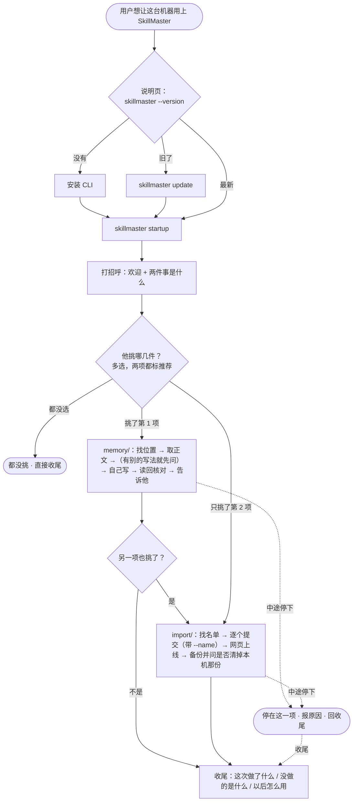

# v26-startup-guidance-and-agent-paths · 产品需求

> **最后更新**：2026-10-27
> **所属版本**：[`README.md`](README.md)

<!--
这是本版需求的权威文档。README 只放摘要，别处不要重复这里的内容。
-->

**2026-10-28 起，本版交付的两组命令已经不在了**：`prompt install` / `status` / `update` / `uninstall` 退役，`startup --plan`（连同 `--agent` / `--file`）删除——见 [v27](../v27-rule-block-and-prompt-retirement/README.md) 与 [ADR 0110](../../decisions/0110-the-block-is-a-paragraph-the-cli-stops-managing.md)、[ADR 0111](../../decisions/0111-startup-takes-no-flags.md)。**正文主体记的是 v26 当时的样子**（各节写就的时刻不同，技能版本号以那一段为准）。两处例外：**带 v27 / ADR 0110 / ADR 0111 的段落、「小工具」改称「CLI」的地方，是后来回写的**，讲的是现状；其余条文不随 v27 改写。

## 现场：这一版要解决的五个问题

这五个问题来自一次真实的首次旅程（2026-10-27，macOS，CLI `1.1.0-beta (a6ebc2e)`）：用户按 `skillmaster startup` 走完，规则段记在了 `~/.claude/CLAUDE.md`；随后打开 WorkBuddy 与 Codex，规则不在，旅程也说不清下一步。

| # | 现象 | 现场证据 | 后果 |
|---|---|---|---|
| 1 | **审批说不清** | 线上 `skillmaster/startup` 的规则只写「动手前先问人」；第三步只写「这一步改人机器上的文件，动手前先问人」。没有任何一句规定「问的时候要说什么」 | 用户不知道在批准什么、有什么风险、批准后会发生什么、能不能退；只能盲批或拒绝 |
| 2 | **换 agent 不知道要重写** | 规则段是**每个 agent 各一份**的用户级文件。本机 `~/.claude/CLAUDE.md` 有标记段；`~/.codex/AGENTS.md` 存在但没有；`~/.copilot/copilot-instructions.md` 与 WorkBuddy 的用户级记忆都不存在。`prompt.json` 只记了 Claude 那一个文件，`prompt status` 也只报它；`startup` 的状态行只讲 skill，不讲规则段 | 新 agent 不知道 SkillMaster；用户以为「装过一次就都好了」 |
| 3 | **旅程里的路径表本身是错的** | 线上第三步有一张「agent → 文件」表，WorkBuddy 那行写 `~/.codebuddy/CODEBUDDY.md`。WorkBuddy 的用户级记忆实际是 `~/.workbuddy/user-<uid>-<scope>/MEMORY.md`（源码 + 日志核实：`[MemoryCollector] user MEMORY.md dir=… user-773f…-personal scoped=yes`）；`CODEBUDDY.md` 是它的**项目级**上下文候选。本机 `~/.codebuddy/CODEBUDDY.md` 里有我们的标记段，但 WorkBuddy 从未读它 | agent 照着表写，用户以为已经生效；**表把一个错误地址放进了流程，agent 没有理由怀疑它**——而它自己的上下文里（WorkBuddy 的提示词）本来就有正确路径 |
| 4 | **路径错了没人校验** | `prompt install --file <路径>` 只做 `~` 展开与绝对化，没有任何「这个文件会不会被读到」的判断；`~/.codebuddy/CODEBUDDY.md` 就是这样被创建出来的 | 写错位置静默成功；用户与 agent 都不知道写错了 |
| 5 | **不知道自己还差哪几步** | 旅程是一份固定的六步文档；`startup` 的状态行只有一句话（「下一步：搬运」）；用户要重读整份文档才知道自己走到哪，已完成的步骤没有状态 | 重做已完成的步骤，或在「上线 / 写提示词 / 删掉本机副本」之间来回问；换 agent 时更不知道新 agent 缺哪一步 |

**为什么现在做**：v25 把规则段搬进了 CLI（[ADR 0102](../../decisions/0102-the-rule-block-ships-with-the-cli.md)），但旅程第三步仍带着那张表。五个问题都出现在「第一次真的有人照着走」的时刻，它们合起来决定第一次体验。**第 3 条还说明了一件更重要的事：一张写死的表会把错误地址塞进流程，盖过 agent 自己上下文里的信息；客户端改了路径，表也不会知道。第 5 条则是这一版最大的体验改动：旅程不再从第一步开始读，而是先按本机实际状态算出一张清单。**

## 用户与场景

**谁在用**

| 角色 | 在这一版里做什么 |
|---|---|
| **第一次走 startup 的人** | 在 AI 工具里跑 `skillmaster startup`，被要求登录、把技能传到 SkillMaster、正式上线、让 Agent 先来 SkillMaster 找技能；电脑上原来的那份可以留到以后清理。每一次都要点「同意」 |
| **已经走完、换了一个 agent 的人** | 昨天在 Claude Code 里走完，今天打开 Codex / WorkBuddy / Copilot。规则段不在新 agent 里 |
| **agent（客户端与它运行的模型）** | 读旅程、跑命令、向人请示。它知道自己是哪个客户端，通常也知道自己的用户级记忆文件；不确定时先查自己的配置/上下文，再问「你用的是哪个 AI」，然后直接写用户级记忆——不要问路径 |
| **替人装东西的人** | 按安装说明操作，最后一步是 `skillmaster startup`；换 agent 时也要知道再跑一次 |

**本版的边界：只覆盖跑在你自己的电脑上、有本地文件、能打开浏览器的 AI 工具。** 云端托管 / 远程沙箱（例如 Grok bot、WorkBuddy 的云端模式）不在本版：它们没有本机的用户级文件，一般也不能从会话里打开浏览器登录；云端要用一把专用的密钥，安装路径是另一套。这条边界在不做 #16 里记了原因与什么时候再做。

**在什么场景下用**

- **第一次**：agent 说「我要把规则写进系统提示词」，用户在沙箱审批里只看到一条命令或一个路径——不知道写的是什么、写进去以后会怎样、写错了怎么退。**用户听到的是一句技术黑话，而不是「Codex 以后会先来 SkillMaster 找技能」。**
- **换 agent**：用户在 Codex 里打开新会话，问一个该查库的问题，agent 凭记忆答；用户不知道这是因为规则段没写进 Codex 的文件。
- **WorkBuddy**：用户按旅程把规则写进 `~/.codebuddy/CODEBUDDY.md`，WorkBuddy 从来没读它；用户以为已经生效。
- **路径错**：agent 按一张过期的表挑了一个「看起来像」的文件，`prompt install --file` 直接写成功；没有任何一处会说「这个文件不会被读到」。

**现在的替代做法是什么**：重走一遍旅程、手动粘贴、问人。没有一处能回答「这台机器上有哪些 agent、各自写没写、该写哪个文件」——但这一版的答案是：**不要由我们回答「该写哪个文件」，让运行在里面的 agent 回答。**

## 解决思路

**一句话**：**路径由运行它的 agent 决定，不由我们的一张表决定。** CLI 不再维护「agent → 文件」的对照表；它负责把要写的内容、影响和退路摆给人看，并记住这台机器写过哪几份。

### 整体流程



实线是主路径；虚线是中途停下的地方——停下是合法结果，收尾仍要说清做了什么、没做什么。

**传技能是可选的。** 它不在「还差」里，也不挡后面的步骤：人不传、只传一部分、或者传到一半停下，旅程都继续往下走。只有真的传上去的草稿才需要正式上线；一份都没传时，「正式上线」直接算已完成。

### 决定 1 · 不维护 agent → 文件的表

**为什么撤掉表。** 表是第三方对每个客户端的猜测，客户端自己最清楚自己的记忆存在哪。WorkBuddy 这一行就是证明：表写了 `~/.codebuddy/CODEBUDDY.md`，agent 照着写；而 WorkBuddy 实际读的是按账号分目录的 `MEMORY.md`，它自己的提示词里就有这个路径。**表把一个错误地址放进了流程，agent 没有理由怀疑它；而客户端改了路径，表还会滞后。**

**那谁来定路径？**

- **agent 自己定**：它知道自己跑在哪个客户端里。WorkBuddy 的提示词里直接给了 `File: ${r}/MEMORY.md`；Claude Code、Codex 的模型知道自己的 `CLAUDE.md` / `AGENTS.md` 约定；Cursor、OpenHands 知道自己只能在应用内设置。
- **不确定就先查自己的配置/上下文，再问「你用的是哪个 AI」**：用户知道这个 AI 的名字，但不知道文件路径。不要问路径，直接写用户级记忆；agent 不许「挑一个看起来像的」。
- **只写用户级**：整台机器、所有项目生效的那一份；项目级文件只影响一个仓库，不是这一步的对象。
- **有更高优先的覆盖文件时，写实际会被读的那份**：例如 Codex 的 `AGENTS.override.md` 优先于 `AGENTS.md`。这是原则，不是一张表——agent 按自己客户端的实际行为判断。
- **只能在应用内设置的客户端不写文件**：agent 用 `skillmaster prompt print` 打印正文，请用户在应用内粘贴。

**旅程给什么？** 不给整张表，给四句话（五条原则）：

> - 写进**你这个客户端**的用户级指令/记忆文件——整台机器、所有项目都会读到的那一份。
> - 你知道它在哪里（或能从你这个客户端的配置里找到）；不确定就问「你用的是哪个 AI」，再直接写用户级记忆；不要问路径，也不要停在设置界面。
> - 如果这个客户端有更高优先的覆盖文件，写实际会被读的那一份。
> - 如果它只能在应用内设置，不要找文件：打印出来，让用户粘贴。

**CLI 还能做什么检查？** 不猜路径，但做四件通用的事：

1. `--file` 必须是文件（不是目录），父目录必须存在——不替人建目录。
2. 路径必须在用户主目录下；不在就拒绝，`--force` 可越过（给镜像、XDG 在外的少数情况留口）。
3. 路径落在**当前项目目录**里、而当前目录不是主目录时，计划里明确警告「这个位置只对当前项目生效；我们想让它对整台电脑生效」——由人确认。
4. 计划里**不主动打印路径**；审批框里已经显示路径时，用户问起再用一句话说明它是哪个文件。

`--force` 只越过「不在主目录下」这一条检查，**不等于同意写入**；仍然要在计划之后带 `--yes` 才落笔。

**这一版不再声称 CLI 能判断「这个路径会不会被读到」。** 它只做上面四条通用检查；「会不会被读到」由 agent 对自己客户端的知识、人的确认、以及以后新任务里的实际使用回答。**本版不要求用户关掉再打开，也不把试用做成清单项**：写完只告知「这段说明已经写进全局记忆，以后开新任务会用 SkillMaster 来读写技能」。写错通常会在新任务里暴露：规则没加载时 agent 不会先跑 `skillmaster skills search`。

**记录什么？** 旧版 `prompt install` 会把写过的文件与 `--agent` 标签记进 `prompt.json`；这组命令退役后不再有新记录；`startup` 本人只读它，用来打那一行「这台电脑上写过这段说明的 Agent：…」（[ADR 0110](../../decisions/0110-the-block-is-a-paragraph-the-cli-stops-managing.md)、[ADR 0111](../../decisions/0111-startup-takes-no-flags.md)）。

**写这个动作由 agent 做，CLI 不再管理这段拷贝**（2026-10-28，[ADR 0110](../../decisions/0110-the-block-is-a-paragraph-the-cli-stops-managing.md)）。v26 当初让 `prompt install` 写、用两行 HTML 注释定位；标记段连同写、查、更新、撤回这一整组命令一起退役了——这段说明是用户自己文件里的一段话，不该带机器标记。

- `prompt print`：打印二进制自带的正文（不再含标记），断网、没有凭据也能用。
- `prompt install` / `prompt status` / `prompt update` / `prompt uninstall`：**全部退役**。命令还在，只回答三行退役说明（首行「已经退役」，另两行指向 `prompt print` 与 `skillmaster startup`），退出 2；帮助页里只留 `prompt print`（命令树 65 → 61）。
- **代价如实说**：CLI 不能替人更新或撤回这段说明。要更新，重跑 `startup` 写一遍；要撤回，用户自己删掉那几行。
- `startup` 加一行**记录行**（本地、best effort）：把记录里的 agent 标签（没有标签就写「未命名」，不显示路径）列出来，并说「如果你不是其中之一，按第三步再写一份」。它不猜当前是哪个 agent；agent 自己知道。没有记录时不打印。
- **写完就告知，不要求重启**：第三步写完后，agent 直接告诉用户「这段说明已经写进你的全局记忆里；以后开新任务，AI 都会用 SkillMaster 来读写技能」。换一个 agent 不会自动带上规则段——每个 agent 有自己的用户级文件；在新 agent 里重跑 `startup`，从第三步开始再写一份。

### 决定 4 · 先检查、出清单、按清单做、每步报进度

**`skillmaster startup --plan [--agent <名字>] [--file <这个 agent 的用户级文件>]：只读。** 不写任何文件、不拉旅程正文、不钉版本、不打开浏览器。它按本机与平台的实际状态打印一张**产品语言的安装清单**：

| 清单项（用户看到的名字） | 怎么算 | 什么时候跳过 |
|---|---|---|
| **CLI** | 当前版本；有没有新版（与 `update --check` 同一来源；开发构建跳过） | 已是最新 → 已完成 |
| **登录** | 未登录 / 已登录为谁 / 凭据失效 | 有效 → 已完成 |
| **传技能**（可选） | 本机候选目录里 N 个 skill，其中 M 个平台上还没有 | N=0 → 跳过（本机没有可上传的）；N>0 且 M=0 → 已完成；M>0 → 跳过（可选：还有 M 个没传，想传的时候再跑一次）。**任何时候都不进「还差」，也不挡后面的步骤** |
| **正式上线** | K 份草稿在等上线 | 本机没有技能 → 跳过；有本机技能且 K=0 → 已完成 |
| **让 Agent 先来 SkillMaster 找技能** | 按 `--file`（这个 AI 工具当前的文件）读文件，看里面有没有这段正文（忽略换行差异）；没给 `--file` 时按 `--agent` 的旧记录找那份文件。`--file` 仍走同一套通用检查（目录、父目录、主目录、项目级警告），**只报告不写** | 文件里有这段正文 → 已完成 |
| **让 Agent 用 SkillMaster 自己的文件夹** | 本机有没有要清理的副本；CLI 读不到 agent 的权限设置 | 没有要清理的 → 已完成；有本机副本时 → 跳过（可选，清理前才需要） |
| **电脑上原来的那份** | 本机还有 L 个已上线的副本 | L=0 → 已完成（没有要清理的）；L>0 → 跳过（可选，以后也能做） |

每项内部三个状态：已完成 / 有待做 / 跳过或可选，附一句人话；打印时用「已经好了」「还差」「跳过」「还要确认」，不打印符号。清单写「还差 K 件」；已完成收成「已经好了（M 件）」。**「传技能」永远是可选项**：本机还有没传的技能时，它只在「跳过（可选）」里出现，不参与「还差」；必做项都好了时，如果还有没传的技能，补一句「还有技能没传，想传的时候再跑一次」；如果本机还有旧副本，再问「要不要清理电脑上原来那份？（可选）」。

**清单的交互口径**（依据 [`docs/research/onboarding-interaction.md`](../../research/onboarding-interaction.md)：UI Patterns 的 onboarding checklist、NN/g 的确认与进度、clig.dev 的 CLI 约定）：

- **开头一句话说清整件事**：「让这台电脑上的技能，在任何 AI 里都能用。」不要一上来就是七个词。
- **只列还没做的，第一件就是下一步**：待做按顺序列名字，不并列展开七段；已完成收成一行。用户不用在七项里找该做哪件（UI Patterns："start with something ticked"、"one clear action"）。
- **已完成收成一行**：`已经好了（5 件）：CLI、登录、传技能、正式上线、让 Agent 先来 SkillMaster 找技能`；全部完成后不再列清单（"retire it once it is complete"）。
- **每项按「用户得到什么」说**：`让 Agent 先来 SkillMaster 找技能`，不是 `写系统提示词`；动作放在下面一行（"phrase each task as something the user wants"）。
- **可选项告诉人以后在哪做**：`传技能（可选，你电脑上还有 3 个技能没传；想传的时候再跑一次）`、`电脑上原来的那份（可选，删掉它；以后跑 startup --plan 还能看到）`（"state where it can be completed later"）。可选项不做，旅程仍然完成。
- **不谎报**：未知写「登录后检查 / 暂时读不到」，不写 0；没有可靠的剩余时间就不给时间；不报假百分比（NN/g 的进度阈值、UX Tigers 的 "progress theater"）。
- **等待有声音**：开始先打一行「正在检查你的电脑和 SkillMaster…」；传技能 / 删掉电脑上原来的那份这类会碰到很多个东西的步骤，报「第 3 个，共 33 个」（NN/g："Updating address 3 of 50"）。
- **收尾不是「恭喜完成」**：说清做完什么、还剩什么，再指一件以后自然会做的事——「以后开新任务时，问一个需要用到技能的问题，AI 会先用 SkillMaster 来读写技能」。

**清单是只读的，也是诚实的。** 没有登录就不猜平台状态，写「登录后检查」；网络读不到就写「暂时读不到」，不把未知说成 0。退出码：打印出清单就是 0（包括「先登录」）；只有完全算不出来才 1。

**清单给 agent 留一行「下一步」**：stdout 是给人的产品语言（不出现系统提示词、标记段、摘要、路径、命令这类内部词；**CLI 与 Agent 自 2026-10-28 起可以用**，见迭代 0003），stderr 最后一行是 `下一步：<步骤文件>`（或「先登录」「先更新 CLI」「稍后再检查一次」）。agent 读这一行决定下一份要加载的步骤文件；用户不需要看它。**这一行属于 `--plan`**：v26 交付时 CLI 打印的是旧的 `steps/0N-*.md`，与本版技能目录（`memory/`、`import/`）不一致，而且这条旅程早就不再调用它——v27 因此把 `startup --plan` 整个删了（[ADR 0111](../../decisions/0111-startup-takes-no-flags.md)），这条已知问题随之消失。

**CLI 没装的那一段在安装说明页。** 安装说明页只负责到 CLI 能跑（`skillmaster --version` → 安装 / `skillmaster update`），装好之后直接交给 `skillmaster startup`——旅程从打招呼开始。`startup --plan` 在 v26 交付时仍在、仍然只读，但这条旅程不再调用它（见下面「进度由每一步自己的判据给出」）；它在 v27 已删除（[ADR 0111](../../decisions/0111-startup-takes-no-flags.md)）。

**清单选过就是同意了，不再逐步请示**（2026-10-28 产品负责人定，取代原先「清单确认一次，不代替每一步的同意」）。agent 把清单给人看，人挑了哪几项就按项做下去，写说明、传技能、上线都不再单独问一遍。**只有三类事要问，而且问的都不是「做不做」**：同名技能留哪份、要不要换掉已经存在的那套写法、要不要清掉电脑上原来那份——每一处都要带推荐和理由。删本地文件那一步仍必须**先备份、再问、他点头才动手**。

**进度由每一步自己的判据给出，不靠 `--plan` 重算**（2026-10-28 产品负责人定，取代原先「每步做完重新跑一次 `--plan`」）：传完看 `submit` 的结果，上线看 `skills pending`，写完说明把文件读回来比对。`startup --plan` 在 v26 交付时仍然只读、仍然可用，但这条旅程不再调用它（v27 删除，[ADR 0111](../../decisions/0111-startup-takes-no-flags.md)）。失败就停在那一步，清单仍指着它。全部做完后给一份收尾报告：做完了什么、还剩什么（例如电脑上原来的那份没删）、以后怎么用；**最后指一件以后自然会做的事**（「以后开新任务时，问一个需要用到技能的问题，AI 会先用 SkillMaster 来读写技能」），不是一句「恭喜完成」。**大步骤内部也要有声音**：传技能、删掉电脑上原来的那份这种会碰到几十个技能的步骤，逐个报「第 3 个，共 33 个」，整步完成后再重算清单——不要让人对着一个沉默的终端等五分钟。**长步骤可以停**：人说停就停在下一个对象之前，报已完成多少，清单仍指着这一项。

**清单的样子（Claude Code 已完成后切到 Codex）**：

```text
SkillMaster 安装清单
让这台电脑上的技能，在任何 AI 里都能用。

还差 1 件：
1. 让 Agent 先来 SkillMaster 找技能

已经好了（4 件）：CLI、登录、传技能、正式上线。
跳过（2 件）：让 Agent 用 SkillMaster 自己的文件夹（清理电脑上原来那份时才需要；只给 SkillMaster 自己的文件夹）、电脑上原来的那份（可选，以后也能做）。

要从第 1 件开始吗？
```

第一次走的用户看到的是另一张：`还差 2 件：登录、让 Agent 先来 SkillMaster 找技能`；`已经好了（1 件）：CLI`；`跳过（1 件）：传技能（可选；登录后才知道还有几个没传，想传的时候再跑一次）`；`还要确认：正式上线（登录后检查）、让 Agent 用 SkillMaster 自己的文件夹（登录后检查）、电脑上原来的那份（登录后检查）`。平台状态要登录后才读得到，所以这三项不写成待做，也不写成 0。登录后：有本机技能时「传技能」留在「跳过（可选）」并给出没传的个数；本机没有技能时写「本机没有可上传的技能」；「正式上线」只在真有草稿等上线时进「还差」；「让 Agent 用 SkillMaster 自己的文件夹」与「电脑上原来的那份」是可选，不在「还差」里出现。

### 一次典型的旅程

```text
0. 安装说明页：skillmaster --version → 没有就安装 / 旧了就 update
1. skillmaster startup → 打招呼（已登录；说清两件事是什么）→ 多选清单（两项都标推荐）
2. 人挑了哪几项就做哪几项；两项都挑时先做「让 Agent 先来 SkillMaster 找技能」，再做「传技能」
3. 写记忆：读那份文件 → 取正文（prompt print）→ 已经有别的写法就先问 → 自己写进去 → 读回来核对 → 告诉他
4. 传技能：找名单 → 逐个 skill submit --name → 网页上「上线所选」→ 抽一条 invoke 验 → 给一个能照着试的例子 → 备份，再问要不要清掉本机那份
5. 收尾：这次做了什么、没做的是什么、以后怎么用（以后开新任务时，问一个需要用到技能的问题，Agent 会先来 SkillMaster 找）
```

**「让 Agent 先来 SkillMaster 找技能」那一项，展开是这样：**

```text
1. agent 确定「这个 Agent 每次开始都会读的那份用户级文件」；不问用户路径
2. skillmaster prompt print → 去掉首尾两行标记，拿到正文
3. 文件里已经有别的 skill 说明 → 用选项问他换不换（带推荐，只有选换才写）
4. agent 自己写进文件：替换旧说明 / 替换我们的旧版本 / 追加；只动跟找技能有关的行
5. 读回来跟 prompt print 逐字比；写不进去就请求授权，还不行就停
6. 告诉用户：这段说明已经写进全局记忆，以后开新任务会用 SkillMaster 来读写技能
```

**写入由 agent 完成，不走 CLI。** v26 当初让 `prompt install` 写、用标记段定位；2026-10-28 产品负责人改了这一条：写的是给用户看的说明，agent 自己写得出来，也不必在用户的文件里留下机器标记。代价如实记：CLI 不再替人更新或撤回这段说明（重跑 `startup` 才能更新）。`startup --plan` 的「让 Agent 先来 SkillMaster 找技能」改成看文件里有没有这段正文，所以 agent 手写的文件也能判对——**这条判据随后随 `--plan` 一起被删**（[ADR 0111](../../decisions/0111-startup-takes-no-flags.md)），现状以 [v27](../v27-rule-block-and-prompt-retirement/README.md) 为准。

### 什么时候问用户

清单里挑了哪几项，就是同意了那几项——写说明、传技能、上线、备份都不再逐步请示（2026-10-28 产品负责人定，取代原先的「五句话请示」）。**只有三类事要问，而且问的都不是「做不做」**：

1. **同名技能留哪份**（传技能时）——给推荐和理由，不让他选文件。
2. **换不换已经存在的那套写法**（写说明时）——把推荐正文整段摆出来，用选项问。
3. **清不清电脑上原来那份**（备份之后）——必须先备份、再问、他点头才动手。

每一处都**必须带推荐**：推荐哪个写在选项上，为什么写在下面一句。不给他推荐，等于把决定原样丢回去。用用户能懂的话，不出现「标记段」「摘要」「凭据」这类内部词。

### 决定 5 · 备份放在哪

清理本机副本之前先备份。备份是一个 `tar.gz`，默认放在用户主目录：`~/skillmaster-skills-<日期>.tar.gz`；技能分散在几个目录时，一个目录一个包，文件名带上目录名。

- **先备份、再问、他点头才删**：备份完先 `tar -tzf` 逐个核对，每个技能都在、数目对得上，核对不过就不删。
- **只删这次上线成功、且已经备份过的那些目录**；没传成、没上线的不动。
- **不再需要单独的 `.skillmaster` 授权**（2026-10-28 定）：备份不在 `~/.skillmaster/` 里，原先「安装时给一个文件夹一次权限」那一步连同 `06-permission` 一起删掉了。

## 给用户的措辞（锁定）

**为什么要有范本。** 清单给的是结构，措辞决定用户读不读得懂。2026-10-27 的走查里，agent 的每句话都是临场发挥：有时只说「要写入文件了」，有时把内部词（标记段、摘要）直接抛给用户。第一版范本按 `voice-spec` 的书面陈述写，用户看完的反馈是「还是过于生硬且技术」——**我们的读者是不懂代码和技术的人**。这一节因此重写：不是把技术词换成更短的技术词，而是**先说人话，技术动作由 agent 代做**。依据见 [`docs/research/onboarding-interaction.md`](../../research/onboarding-interaction.md) §七（GOV.UK 的 clear language、NN/g 的平实语言与错误消息、UI Patterns / MetLife 的对话式引导）。

**这是 `design/voice-spec.md` 的一个明确例外。** 控制台界面仍按 voice-spec（读者是管理 skill 的作者）；`skillmaster startup`、`prompt install` / `prompt uninstall` 的计划输出，以及 agent 在安装对话里对用户说的话，按这一节——口语、短句、一次一个问题、不出现技术词。这条例外记在 [ADR 0107](../../decisions/0107-startup-speaks-to-non-technical-users.md)，voice-spec §一 也指向它。

**三条口径**

**语气**：像一个人在旁边帮你装，不像说明书。称「你」；一句话一个意思；每句话先讲对用户的影响，再讲动作；不推销、不打气、不写「搞定 / 恭喜 / 没问题」；也不居高临下（不写「简单」「容易」「只需要」「小白」）。

**用词**：能不说技术词就不说。必须说时，先说它有什么用，再给名字；同一个东西只在一个名字上。**这张表管的是 agent 对用户说的话，不是控制台界面标签**——控制台的按钮仍按 voice-spec。

| 内部词 | 对用户说 | 第一次出现时补一句 |
|---|---|---|
| CLI / 命令行 / 二进制 | **SkillMaster CLI**（简称「CLI」） | 「它是个装在这台电脑上的命令行工具，帮你的 Agent 连上 SkillMaster。」 |
| agent / 客户端 / 模型 | **Agent**，或直接叫它的名字（Codex、Claude、WorkBuddy） | 2026-10-28 起对用户说 Agent（迭代 0003）；此前是「你用的 AI」 |
| skill / 技能 | **技能** | 「技能就是你让 AI 会做的那套做法，比如写周报、做表格。」 |
| 系统提示词 / 规则段 / 标记段 / 起止注释 | **让 Agent 先来 SkillMaster 找技能的那段说明**；短说「那段说明」 | 「它就像给 AI 留的一张便条。」 |
| 用户级指令 / 记忆文件 | **AI 每次开始都会读的地方** | 不主动给路径；用户问再给 |
| 提交 / 上传 / 落草稿 | **传到 SkillMaster**（先存起来） | 「先存起来，不会马上公开；你还要在网页上点一下才正式上线。」 |
| 上线 | **正式上线** | 「就是让你的技能正式可用。」 |
| 本机副本 / 本地文件 | **你电脑上原来的那份** | — |
| 删掉本机副本 | **删掉电脑上原来的那份**（可选） | 「删之前我先备份好；不删也能用。」 |
| 登录设备 / 凭据 / 令牌 / 会话 | **登录** | — |
| 草稿 | **先存起来、还没正式上线的那份** | 第一次说清，后面可以简称「草稿」 |
| 校验 / 探测 / 扫描 | **看看 / 检查** | — |
| 写入后的告知 | **这段说明已经写进你的全局记忆了** | — |
| plan / 清单 | **还差几步** / **要做的几件事** | — |

**数字**：不报「6/7」这类分数，不说百分比。说「还差 2 件」「这是第 1 件」；清单里的件数由 CLI 算，agent 不改写。大步骤里说「正在传第 3 个，共 12 个」——这是用户能看懂的具体数量，不是假进度。

**一个东西只在一个名字上**：同一个东西不要一会儿叫「CLI」、一会儿叫「CLI」；一会儿叫「你电脑上原来的那份」、一会儿叫「本机副本」。用户听到第二个名字，会以为是另一个东西。

### 消息类型与固定结构

| 时机 | 必须包含 | 最后一句 |
|---|---|---|
| **开场** | 欢迎 + 两件事是什么、每件有什么用 | — |
| **清单（多选）** | 两项都标推荐 | 「两个都推荐，也可以只做一个。」 |
| **三处提问** | 同名技能留哪份 / 换不换已有写法 / 清不清本机那份——每处都带推荐和理由 | 「你看选哪个？」 |
| **进度** | 传一批技能时由 agent 自己逐个报「第 3 个，共 12 个」 | — |
| **失败** | 停在哪件、发生了什么、什么没变、以后怎么继续 | 「我先停在这里；想再试时跟我说一声。」 |
| **跳过可选** | 哪件没做、为什么可做可不做、以后在哪做 | — |
| **收尾** | 这次做了什么、没做什么、以后开新任务时自然会做的一件事 | — |

### 不同情况下的范本

**A. 打招呼与选择**

| 情况 | 用户看到的话（范本） | 不要这样说 |
|---|---|---|
| **打招呼** | 你已经登录了 SkillMaster，欢迎！接下来有两件事，建议都做：一、让 Agent 以后默认来 SkillMaster 找技能；二、把你电脑上的技能传上来。只写说明不传技能，Agent 去了也找不到东西；只传技能不写说明，Agent 不会主动去用。 | 「开始执行 startup 流程。」 |
| **两项都不选** | 好，那就先不弄。想配的时候跟我说一声。 | 「已取消初始化。」 |

**B. 写说明**

| 情况 | 用户看到的话（范本） | 不要这样说 |
|---|---|---|
| **有别的写法** | 你这里已经有一段关于怎么找技能的说明：（一句话说清原来那套）。SkillMaster 推荐这样写，你看要不要换：……（整段正文）1）换成 SkillMaster 的写法（推荐）2）保留原来的。推荐换成 SkillMaster 的：两套规矩都留着，它每次都得自己挑一套；换掉就只剩一套。 | 「检测到已存在的规则段，是否覆盖？」 |
| **写不进去** | 这段说明要写进你的 Agent 每次开始都会读的那个文件，但电脑的安全设置不让我改。你在弹出来的窗口里点允许，我再写一次。 | 「Permission denied。」 |
| **写好了** | 写好了，这段说明已经写进你的全局记忆里。以后每次开一个新任务，Agent 都会自动来 SkillMaster 查找、调用、编辑、整理技能，不用你每次交代。现在这个任务是在写之前开的，还读不到这段说明；想让它现在就用，跟它说一句「用 SkillMaster 管技能」就行。 | 「规则段已写入。」 |

**C. 传技能**

| 情况 | 用户看到的话（范本） | 不要这样说 |
|---|---|---|
| **有本机技能** | 你电脑上有 12 个技能。我把它们传到 SkillMaster——先存着，不会马上公开，你还要在网页上点一下「上线所选」。 | 「扫描到 12 个 skill，准备提交。」 |
| **同名但内容不同** | 你电脑上有两份都叫 X 的技能：一份更新、文件更全，另一份旧一些。我建议传新的那份，旧的先留在电脑上；你看行吗？ | 「检测到同名 skill，请选择覆盖或跳过。」 |
| **没有本机技能** | 你电脑上暂时没有可上传的技能，这件跳过，直接做下一件。 | 「N=0，跳过提交。」 |
| **上线** | 传完了。还差一步在网页上：把要用的技能勾上，点「上线所选」。链接我发你，弄好了跟我说一声。 | 「提交完成，请前往控制台发布。」 |
| **上线完了** | 上线完了，这次传上来的 N 个技能现在都能用了。试一下：跟你的 Agent 说「用 SkillMaster 找一下<名字>」——它会先去 SkillMaster 搜，搜到就直接用上。 | 「publish 完成，exit 0。」 |

**D. 备份与清理**

| 情况 | 用户看到的话（范本） | 不要这样说 |
|---|---|---|
| **问要不要清** | 备份好了，放在 <位置>，以后想找回来跟我说一声。这一步只会删这次上线成功、刚备份过的那 N 个技能；没传成、没上线的都不动。删完以后，这 N 个只从 SkillMaster 拿，不会再从电脑上读一遍。不删也照常用。1）清掉，备份留着（推荐）2）先留着。推荐清掉：留着每次都会读到两遍；备份在手，想拿回来随时能拿。 | 「检测到 12 个已上线 skill 的本机副本，是否删除？」 |
| **备份没成** | 我先停在这里：备份没成，电脑上的技能一个都没动。 | 「备份失败，继续删除。」 |

**E. 收尾**

| 情况 | 用户看到的话（范本） | 不要这样说 |
|---|---|---|
| **都做成了** | 这次做了：（列出来）。都好了。以后开新任务时，你问一个需要用到技能的问题，Agent 会先来 SkillMaster 找。 | 「startup 完成，exit 0。」 |
| **有没做成的** | 这次做了：（列出来）。没做的是：（列出来）——以后想接着做，跟我说一声。 | 「部分失败。」 |

### 禁用

- **技术词**：命令行、二进制、客户端、模型、系统提示词、规则段、标记段、起止注释、摘要、路径、命令、配置、凭据、令牌、会话、搬运、本机副本。**CLI 与 Agent 自 2026-10-28 起是正式称呼，不在此列**（迭代 0003）。用户自己说「系统提示词」时可以跟着说，但不要主动用；必须用时，先用大白话解释它有什么用。
- **「确定吗？」**——三处提问都给具体选项并带推荐，不要泛泛地问「确定吗？」。
- **「恭喜 / 搞定 / 没问题」**——说事实和下一步；不替用户庆祝。
- **「简单 / 容易 / 快速 / 只需要 / 小白」**——不替用户评价他自己；也不居高临下。
- **「应该 / 大概 / 稍等」**——说正在做什么、还差几件；不知道就说不知道。
- **「发布」指上线**——用「正式上线」；网页上的按钮叫**「上线所选」**，确认单叫「确认上线」。
- **「搬运 / 下线本机副本」**——说「传到 SkillMaster」「删掉电脑上原来的那份」。
- **命令与路径**——不主动展示；用户必须自己运行时，给一行可复制的内容，并说清粘贴到哪里、做完说什么。

### 落地

- **话术写进技能正文**：语气、用词对照、消息结构按本节，逐条落在 `SKILL.md` 与各步的「对他说」里，不另开 `voice.md`（原文件已删）。
- **CLI 的计划输出用同一套话**：`prompt install` 的动作行、`startup` 的记录行都用「CLI / 传技能 / 正式上线 / 让 Agent 先来 SkillMaster 找技能 / 电脑上原来的那份」；不出现「系统提示词 / 标记段 / 摘要 / 凭据」。
- **旅程内容同步换话**：`import/` 各步说「传到 SkillMaster」「上线所选」；`memory/03-tell.md` 写完后直接告知「已经写进全局记忆，以后新任务会用」；`import/04-cleanup.md` 先备份、再问要不要清掉本机那份；`memory/` 各步说「让 Agent 先来 SkillMaster 找技能的那段说明」。
- **CLI 与 agent 的分工**：CLI 打印的清单本身就是人话；agent 可以把它说得更暖，但不能改数字、不能加没发生的完成项。用户看到的命令与路径只应出现在两种时候：用户必须自己运行；或者审批框里已经显示了、用户问起。
- **每一步都有退路**：用户说「先不做」，agent 停下并说清已经做好的不会变、怎么继续；不默认同意，不把可选步骤说成必做。
- **验收按范本对照**：人工走查的每一步消息都要能对上上面的情境表与完整范本；不是「大概像」，是结构齐全、词对、技术词为零。

## 范围

### 做

| # | 做什么 | 交付形态 |
|---|---|---|
| 1 | **旅程删掉路径表**：`memory/01-locate.md` 不再有「agent → 文件」的整张表，改为四句原则（用户级、自己确定、覆盖文件、应用内）+ `prompt print` 取正文 + agent 自己写入 + 读回核对；写明写入由 agent 完成、不走 CLI、不留标记段 | 平台技能内容（技能主人在控制台发布） |
| 2 | **`SKILL.md` 只保留三处提问**：清单里选了就做，只有同名技能、换不换写法、清不清本机那份要问，且每处都带推荐 | 平台技能内容 |
| 3 | **`prompt install` 计划先行**：`--file` 必填；`--agent` 可选标签；不给 `--yes` 只打印 我要做什么 / 只会动到什么 / 做完会怎样 / 不想做了怎么办 / 不做会怎样 并退出 1；不写用户文件；不读 stdin | CLI |
| 4 | **通用路径检查**：不是目录、父目录存在、在主目录下（否则 `--force`）；落在当前项目目录且当前目录不是主目录时，计划里提醒「这看起来只影响一个项目」 | CLI |
| 5 | **多文件记录 v2**：`prompt.json` 记一组 `{path, agent, digest}`；v1 单文件记录按一条读入；`prompt update` 覆盖全部；`prompt status` 逐个报告；任一记录文件的摘要与二进制不同、且文件还在时，仍按 v25 的规则在命令 stderr 提示一次 | CLI |
| 6 | **`prompt uninstall`**：按 `--file` 或全部记录，去掉两个标记之间的内容，文件保留；`--yes` 才动；用于换 agent、写错位置、验证失败 | CLI |
| 7 | **`startup` 记录行**：本地、best effort；把记录里的 agent 标签列出来（没有标签就写「未命名」，**不显示路径**，与验收 17 同一口径），提示「如果你不是其中之一，重跑 startup 选第一项再写一份」；没有记录时不打印 | CLI |
| 8 | **写完读回核对**：`memory/02-write.md` 把那段读回来，跟 `prompt print`（去掉标记）逐字比、忽略换行差异；同时确认旧说明已不在、文件其它内容没动 | 平台技能内容 |
| 9 | **写完后的告知与换 agent**：写入成功后告诉用户「这段说明已经写进你的全局记忆里；以后开新任务，Agent 都会用 SkillMaster 来读写技能」；**不要求关掉再打开，也不把试用做成步骤**；换 Agent 要重做这一项，因为每个 Agent 有自己的用户级文件 | 平台技能内容 |
| 10 | **研究文档修正**：`docs/research/agent-context-loading.md` 的 WorkBuddy 行改成按账号分目录的用户级记忆、补 `CODEBUDDY.md` 是项目级；并把「旅程应该抄表」改成「旅程不抄表，表供人核对」。**这两处已在本 PRD 起草时先行改正（2026-10-27）** | 仓库文档 |
| 11 | **两条 ADR**：0104「指令文件的位置由运行它的 agent 决定，不由 CLI 维护对照表」；0105「写进用户文件的动作先出计划，`--yes` 才落笔」 | ADR |
| 12 | **文档同步**：CLI `README.md`（首写也要 `--yes`）、安装说明页（换 agent 再跑 `skillmaster startup`）、`docs/target/README.md` §六加一行 v26 的差异 | 仓库文档 |
| 13 | **写不进去时的说明**：沙箱或只读 `$HOME` 拒绝写入时，打印一条可在终端原样重跑的命令；不重试、不绕过（WorkBuddy 的沙箱实测过 HOME 只读，v22 / v24） | CLI |
| 14 | **`startup --plan [--agent <名字>] [--file <这个 Agent 的用户级文件>]`**：只读；按 CLI / 登录 / 传技能 / 正式上线 / 让 Agent 先来 SkillMaster 找技能 / 让 Agent 用 SkillMaster 自己的文件夹 / 电脑上原来的那份 算七项清单；stderr 最后一行给 agent 指下一步。**这条旅程不再调用它**，而且两处已经跟不上正文：`steps/0N-*.md` 的指针与本版技能目录（`memory/`、`import/`）不一致；「让 Agent 用 SkillMaster 自己的文件夹」对应的授权对象已经不存在。**这两处加上「没有调用者」，是 v27 删除它的理由**（[ADR 0111](../../decisions/0111-startup-takes-no-flags.md)） | CLI |
| 15 | **清单的诚实退化**：没登录不猜平台状态（写「登录后检查」）；网络读不到写「暂时读不到」，不把未知说成 0；开发构建不检查 CLI 更新 | CLI |
| 16 | **安装说明页的第 0 步**：`skillmaster --version`——没装就安装、旧了就 `skillmaster update`，装好后交给 `skillmaster startup`；「没装 / 旧了 / 已是最新」三种情况由说明页负责到底 | 站点文档（只改文字） |
| 17 | **旅程改成两项清单**：`SKILL.md` 与各步文件写明——打招呼说清两件事、多选清单（两项都标推荐）、挑了哪项做哪项（先写说明、后传技能）；写说明由 agent 自己完成、不留标记段、写完读回核对；传技能逐个 `skill submit --name`、网页上「上线所选」、抽一条 `skill invoke` 验、给一个能照着试的例子，再备份并问要不要清掉本机那份；**不要求关掉再打开、不把试用做成步骤**；**传技能是可选的：人拒绝、只传一部分、传到一半停下，都不算失败、不阻塞**；同名但内容不同的本机技能，agent 用一句大白话说清哪份更新/更全并给推荐；收尾说清做了什么、没做什么，最后指一件以后自然会做的事 | 平台技能内容 |
| 18 | **ADR 0106**：startup 先按实际状态出清单，已完成/不适用的步骤不重走；清单只读，进度靠重新计算而不是记一份状态 | ADR |
| 19 | **面向非技术用户的措辞范本进技能内容**：把语气、用词对照、消息结构、情境范本逐字写进 `SKILL.md` 与各步的「对他说」；用户可见词统一为「CLI / 传技能 / 正式上线 / 上线所选 / 让 Agent 先来 SkillMaster 找技能 / 电脑上原来的那份」 | 平台技能内容 + CLI 文案 |
| 20 | **ADR 0107**：启动旅程面向非技术用户——口语、短句、一次一个问题、技术动作由 agent 代做；控制台仍按 voice-spec。这是 `design/voice-spec.md` 的明确例外，voice-spec §一 指向它 | ADR |
| 21 | **备份与清理**：清理本机副本之前先 `tar -czf` 备份到 `~/skillmaster-skills-<日期>.tar.gz`（多目录时一目录一包），`tar -tzf` 逐个核对齐全；再用选项问「清掉 / 先留着」（带推荐）；只有选清掉才删，且只删这次上线成功、刚备份过的目录；备份不成或包不全时绝不删 | 平台技能内容 |
| 22 | **传技能可选**：人拒绝、只传一部分、传到一半停下，都不算失败、不阻塞；只传了部分时「正式上线」只针对已传的草稿；一份都没传时这一项算没做；旅程完成不要求本机技能全部上线；`import/` 各步明说可选与不阻塞 | 夹具：本机有未传技能 / 部分已传 / 全未传；读线上技能正文 |

**规则段的正文在 2026-10-28 改了**（[ADR 0109](../../decisions/0109-the-rule-block-defaults-to-searching-first.md)）：从条件式的三行改成「默认先查、只有闲聊免查」的五条铁律。这条改动由 [v27](../v27-rule-block-and-prompt-retirement/README.md) 交付（正文、命令面、验收都在那里），v26 这边只有 [0005](iterations/0005-rule-block-searches-by-default.md) 一条指路的记录。

**这一版不新增服务端接口、不改数据库、不改控制台与站点的页面结构。** 所有判断都在本机：文件在不在、是不是目录、在不在主目录下。安装说明页只改一段文字。

### 不做

| # | 不做什么 | 为什么 | 什么时候可能做 |
|---|---|---|---|
| 1 | **维护 agent → 用户级文件的对照表**（在 CLI 里或在旅程里） | 表是第三方猜测，会过期、会把错误地址塞进流程，盖过 agent 自己上下文里的信息——WorkBuddy 这一行就是证据。撤掉表，路径由运行在客户端里的 agent 自己确定；确定不了就停下，不问用户 | 出现一个客户端官方提供的「我的用户级文件在哪」接口，或 agent 普遍无法回答时再考虑 |
| 2 | **`prompt install --all` / 自动扫描本机 agent** | 没有表就不知道「本机有哪些 agent、各自读哪」；扫描只能扫目录，不能扫出「读哪个文件」，扫出来又会变成一张表 | 同第 1 条 |
| 3 | **按已知路径拒绝**（例如拒绝 `~/.codebuddy/CODEBUDDY.md`） | 没有表就没有「已知路径」；CLI 只能做通用检查（目录、父目录、主目录），并在计划里把路径给人看。**代价如实说**：写错一个「看起来像」的路径，CLI 不会拦，只能靠写入后的告知、读回核对与以后新任务里的实际使用 | 同第 1 条 |
| 4 | **写项目级指令文件** | 用户级才是「这个 agent 以后都走 SkillMaster」；项目级只影响那一个仓库。计划里的项目路径警告就是为了挡住这种误选 | 用户提出「只给这个仓库」的真实需求 |
| 5 | **自动写应用内设置（Cursor / OpenHands）** | 它们没有可写的用户级文件；CLI 打印 `prompt print` 的正文，让人在应用内粘贴 | 客户端提供可写的用户级文件 |
| 6 | **删文件或删备份** | [ADR 0101](../../decisions/0101-the-cli-never-deletes-files.md)：CLI 不引入删除。`prompt uninstall` 只去掉标记段，文件本身保留 | 不做 |
| 7 | **改规则段正文** | 规则段是每个会话都会读到的东西；改正文会让所有用户收到一次「旧版」提示。换 agent 的提醒放在 `startup` 记录行与旅程里 | 规则段本身需要描述新命令时（随 CLI 版本走） |
| 8 | **跨机器同步记录** | 本机写过哪几份，是这台机器的事实；同步会制造第二个真相 | 有真实的「多机同一人」需求 |
| 9 | **从环境变量猜「当前是哪个 agent」** | 猜错会得出错误的「你写过了」；agent 自己知道名字，`startup` 的记录行由它自己对照 | 出现一个稳定的、跨客户端都有的标识再说 |
| 10 | **控制台 / 站点页面结构改动** | 本版只有 CLI 与平台技能内容；没有新的界面状态。安装说明页只改一段文字 | 不做 |
| 11 | **把进度存成一份状态文件**（「做到第几步」） | 状态是算出来的，不是记出来的：本机 skill、草稿、登录都会变；存一份进度会和事实漂移，还得处理它坏了怎么办。每一步自己的判据就够 | 清单的计算变贵、或需要离线续跑时再考虑 |
| 12 | **拿到清单后自动跑完** | 清单挑过就是同意了，但只限他挑的那几项；没挑的不做。三类提问（同名留哪份 / 换不换写法 / 清不清本机那份）仍然要问 | 不做 |
| 13 | **在清单里假装能验证「规则真的加载了」** | CLI 不在 agent 里常驻，读不到 agent 的会话状态；能验证的是文件与记录。本版只告知用户「以后新任务会用到」，不把「加载了没有」做成清单项，也不要求关掉再打开 | 客户端提供「已加载的指令」接口时再说 |
| 14 | **把用户技能的正式上线做成 CLI 命令** | **高风险**：上线改变「谁能看见 / 调用」，按 [ADR 0081](../../decisions/0081-every-console-operation-has-a-cli-command.md) 留在控制台，用网页确认。旅程只把用户带到网页，CLI 不代做 | 产品负责人逐条确认要改时（ADR 0081 的例外） |
| 15 | **把编辑 / 上线 `skillmaster/startup` 做成 CLI 命令** | **高风险**：改的是所有用户第一次看到的引导；[ADR 0061](../../decisions/0061-what-a-credential-may-do-to-versions.md) 规定这类改动只在网页做。本版只是准备内容 | 产品负责人确认时（ADR 0061 / 0081 的例外） |
| 16 | **云端 / 远程 AI 的安装流程**（例如 Grok bot、WorkBuddy 云端模式、托管沙箱） | 它们没有本机的用户级文件、一般不能从会话里打开浏览器登录；凭据要用 API key，涉及创建、保管、轮换、撤销与云端注入，是另一套安装路径。本版先把本机终端跑通 | 本机流程验收通过后，单独开一版 PRD；先写 API key 的获取与保管，再写云端注入与验证 |
| 17 | **把传技能做成必做项**（没传完就不能往下走） | 本机技能可能很大、含不适合上传的内容，或者用户只想先把 AI 配置好；强制迁移会把第一次旅程卡在第一件，也违背「可选步骤不做，旅程仍然完成」。没传的技能留在电脑上，想传的时候再跑一次 | 产品负责人明确要求「必须完成迁移」时，另做一次独立的迁移任务，不塞回第一次旅程 |

## 控制台操作与 CLI 对应

**本版不新增控制台操作。** 旅程会把用户带到网页做两件既有的事：① 把自己的技能正式上线（高风险，按 [ADR 0081](../../decisions/0081-every-console-operation-has-a-cli-command.md) 留在控制台）；② 技能主人编辑并上线 `skillmaster/startup` 的新内容（同样是既有操作，[ADR 0061](../../decisions/0061-what-a-credential-may-do-to-versions.md)）。两件都不是本版新增的界面，也没有本版新增的 CLI。

| # | 控制台操作 | CLI 命令 | 备注 |
|---|---|---|---|
| 1 | 编辑并上线 `skillmaster/startup`（`SKILL.md`、`memory/` 三份、`import/` 四份，共 8 个文件） | `skillmaster skills pending`（核对队列）、`skillmaster skill read`（核对线上正文）、`skillmaster prompt status`（核对本机记录） | 上线本身由技能主人在网页点；不是本版新增 |
| 2 | 把自己的技能正式上线（旅程「正式上线」那一步） | 无 | **高风险**，按 ADR 0081 留在控制台；旅程只把用户带到网页，CLI 不代做 |

## 验收与指标

### 验收标准

| # | 验收标准 | 怎么判定 |
|---|---|---|
| 1 | **旅程里没有路径表**：线上 `memory/01-locate.md` 不含任何「agent → 文件」的对照表；只有「用户级」「你自己确定」「覆盖文件」「应用内粘贴」这几条原则；`SKILL.md` 里只有三处提问 | `skillmaster skill read` 读线上文件，逐条对照 |
| 2 | **WorkBuddy 写对**：在一个真实的 WorkBuddy 会话里，agent 依据自己上下文里的用户记忆路径，把那段说明写进 `~/.workbuddy/user-<uid>-<scope>/MEMORY.md`，不是 `~/.codebuddy/CODEBUDDY.md`；写完读回与 `prompt print` 一致；在新任务里问一个该查库的问题，agent 先跑 `skillmaster skills search` | 真机由人看 transcript 与写入路径（本版成立条件） |
| 3 | **通用路径检查**：`--file` 指向目录 → 拒绝；父目录不存在 → 拒绝；路径在主目录之外 → 拒绝，`--force` 可越过（越过之后仍要 `--yes` 才写）；路径在当前项目目录、当前目录不是主目录 → 计划里有「这个位置只对当前项目生效；我们想让它对整台电脑生效」的警告 | 四组夹具，查退出码与输出 |
| 4 | **CLI 的计划先行**（本版不改这条 CLI 行为）：`prompt install` 与 `prompt uninstall` 不给 `--yes` 时只打印计划并退出 1；目标文件字节不变；文件里已有逐字相同的段时只更新记录、退出 0。**旅程不再调用 `prompt install`**，见验收 10 | 前后字节 / mtime；计时 |
| 5 | **多文件记录与更新**：写两个 agent → `prompt status` 两行；全部一致时退出 0，任一文件缺失 / 不一致时退出 1；其中一个文件是旧摘要时，任一普通命令的 stderr 提示一次；`prompt update --yes` 两个都换成新版；v1 的 `prompt.json` 仍能读、不丢文件 | 夹具 v1 记录 + 双文件；改二进制里的 block 摘要后跑 update |
| 6 | **`--agent` 只是标签**：传一个 CLI 从来没见过的名字也能写、能记录；`prompt status` 原样显示；不因为它不在任何名单里而拒绝 | 用 `--agent 一个随意的名字` 跑一次 |
| 7 | **撤销**：`prompt uninstall --file X --yes` 只去掉标记段，段外字节不变，文件仍在，记录去掉该条；`prompt uninstall --all --yes`（全部记录）清掉所有记录里的标记段；无 `--yes` 时什么都不动 | 夹具标记段前后各有内容；前后比对 |
| 8 | **`startup` 记录行**：记录里有两个 agent 标签 → 一行按标签原样列出（例如「Claude Code、WorkBuddy」），并说「如果你不是其中之一，重跑 startup 选第一项再写一份」；没有记录 → 没有这一行；该行由本地记录生成，不新增服务端请求 | 夹具记录 + 假服务端计请求 |
| 9 | **写完的核对与换 Agent**：`memory/02-write.md` 把那段读回来跟 `prompt print` 比对；`memory/03-tell.md` 写完后直接告知「已经写进全局记忆，以后新任务会用」；明说「换 Agent 要重做这一项」，**不要求关掉再打开** | `skillmaster skill read` 读线上文件 |
| 10 | **三处提问**：人工走查同名技能、换不换已有写法、清不清本机那份三个动作——每处都用选项问、都标了推荐并给出理由；写说明与传技能本身不再逐步请示；删除只在用户选「清掉」之后发生 | 人看 transcript / 截图；三个动作各一次 |
| 11 | **清单：第一次走的人 / CLI 旧了**：`startup --plan` 开头一句话目的；只列还没做的，第一件就是下一步；已完成收成「已经好了（M 件）」；列出 CLI / 登录 / 传技能 / 正式上线 / 让 Agent 先来 SkillMaster 找技能 / 让 Agent 用 SkillMaster 自己的文件夹 / 电脑上原来的那份；没有已完成的项被跳过；**传技能在「跳过（可选）」里，不在「还差」；不管本机有几个技能没传，「还差」的件数都不包含它**；清单写「还差 K 件」；stderr 最后一行指向 `steps/0N-*.md` 或「先登录 / 先更新 CLI / 稍后再检查一次」。CLI 有新版时，该项写「CLI 有新版本，先更新一下」；更新后重跑清单进入「已经好了」 | 夹具：新 HOME，有本机 skill，未登录；再放一个「旧版二进制 + 假发布源」夹具 |
| 12 | **清单：已完成 Claude、切到 Codex**：同一台机器、`--agent codex --file ~/.codex/AGENTS.md`：CLI / 登录 / 正式上线 / 电脑上原来的那份进入「已经好了」或「跳过」；**传技能在「跳过（可选）」里（本机技能都已上线时写「已经好了」）**；只有「让 Agent 先来 SkillMaster 找技能」在「还差」里；「让 Agent 用 SkillMaster 自己的文件夹」在「跳过」里；清单写「还差 1 件」；把该 `--file` 对应的 Codex 记录改成旧摘要后，「让 Agent 先来 SkillMaster 找技能」写「要更新」而不是「已经好了」；记录里 Claude 的文件与 `--file` 不同时，清单说清「记录里还有另一个文件」 | 夹具：已有 Claude 记录与线上数据；比对清单 |
| 13 | **清单：本机没有 skill**：传技能 / 正式上线两项进「跳过」，让 Agent 用 SkillMaster 自己的文件夹与电脑上原来的那份进「已经好了」（清单只列名字），不要求用户读这几步 | 夹具：空本机、已登录；比对清单 |
| 14 | **清单只读且诚实**：跑 `--plan` 前后：`prompt.json`、目标文件、`update.json` 哈希不变；没有旅程正文请求 / pin；未登录时写「登录后检查」而不是 0；断网时写「暂时读不到」而不是 0；开发构建不检查 CLI 更新；开始有「正在检查…」一行，输出里没有假百分比；`--file` 指向目录 / 父目录不存在 / 主目录外 / 项目目录时，清单提前给出与 install 相同的警告（只报告不写） | 前后哈希；假服务端计请求；断网 / 无凭据夹具；四组路径夹具 |
| 15 | **每步自己判进度**：传完看 `submit` 的结果，上线看这次那几份还在不在待上线队列、并用 `skill invoke` 抽验，写完说明把文件读回来比对；**只传了一部分时照样往下走**；大步骤内部逐个报（「第 3 个，共 12 个」），人喊停就停在下一个对象前；收尾说清做了什么、没做什么，并指一件以后自然会做的事 | 夹具 + 人工走查 |
| 16 | **安装说明页的第 0 步**：`skillmaster --version` 三种情况：没装 → 安装；旧了 → `skillmaster update`；最新 → 交给 `skillmaster startup`；说明页不再替旅程跑 `--plan` | 读线上说明页 + 三种夹具（没装的那段由人走查） |
| 17 | **清单的产品语言**：每项按「用户得到什么」说（「让 Agent 先来 SkillMaster 找技能」而不是「写系统提示词」），附一句人话（「你电脑上还有 12 个技能没传」）；不出现「系统提示词 / 路径 / 命令 / 标记段 / 摘要 / 凭据」这类内部词（CLI 与 Agent 是正式称呼）；已完成收成「已经好了（M 件）」，待做按编号 | 人工读输出 |
| 18 | **措辞按范本**：人工走查的每次消息能对上上面的表格——开场 / 清单 / 三处提问 / 进度 / 失败 / 跳过 / 收尾各有固定结构；禁用词（系统提示词、路径、命令、标记段、摘要、凭据、确定吗、恭喜、简单、只需要）一个不出现（CLI 与 Agent 是正式称呼）；进度说「还差 2 件」，不出现分数；每个提问停在一个问题上 | 人看 transcript / 截图；对照 PRD 的范本 |
| 19 | **契约与跨平台不回退**：帮助契约（八项、≤ 2 KB、无 ANSI）、`prompt print` 与源码逐字节一致、退出码 0/1/2/4、`check_docs.py` 退出 0、`windows-latest` 作业绿 | 既有测试 + CI |
| 20 | **备份先于删除**：人工走查清理流程——备份生成并核对齐全后，才出现「清掉 / 先留着」的选项；选先留着时一个目录都不删；选清掉时只删这次上线成功、刚备份过的目录；备份失败或包不全时绝不删 | 人看 transcript 与文件系统；至少一个真机 |

**成立条件**：**2、5、10、12、14、15、18、20** 是「不满足就不算交付」——2 是 WorkBuddy 用户真的被修好，5 是换 agent 之后更新还能覆盖全部，10 是三处提问必须带推荐的唯一验收方式，12 是换 agent 时清单必须只列出缺的那一步，14 是 `--plan` 只读且不把未知说成 0，15 是「每步自己判进度」的唯一验收方式，18 是面向非技术用户的措辞范本被真正执行，20 是删除必须发生在备份之后。

### 指标

| 指标 | 定义 | 怎么量 | 目标 |
|---|---|---|---|
| 旅程里的路径表行数 | `memory/01-locate.md` 里「agent → 文件」对照表的行数 | 读线上文件 | 0 |
| 提问带推荐率 | 人工走查的三处提问里，选项上标了推荐、并给出理由的比例 | 三次走查，逐次记录 | 3/3 |
| 换 agent 补齐的步骤数 | 在新 agent 里从跑 `startup` 到写完读回核对的消息往返次数 | 一次真实走查（Codex 或 WorkBuddy） | ≤ 4 轮（清单、`prompt print`、写入、核对） |
| 每次写操作多出的进程调用 | 计划 + 落笔两次调用，对比 v25 的一次 | 计数 | +1，且不增加网络请求 |
| `prompt status` 的耗时 | 本机 4 条记录时的端到端耗时 | `time` 跑 20 次取 p95 | ≤ 100 ms |
| 清单跳过已完成步骤 | 在「Claude 已完成后切到 Codex」夹具里，清单列为待做的件数 | 数「还差」里的编号 | 还差 1 件 |
| 清单耗时 | 已登录、有本机 skill、有草稿时，`--plan` 的端到端耗时 | `time` 跑 20 次取 p95 | ≤ 5 s（服务端 3 s + 更新检查 2 s，顺序跑） |
| 进度报告 | 每一步是否按自己的判据报进度、有没有把不确定写成已完成 | 人工走查逐次数 | 每步一次；误报 0 |
| 用户确认次数 | 整趟旅程里用户点头的次数：清单 1 次 + 三处提问（都不是「做不做」） | 人工走查 | 清单 1 次；写说明与传技能不再逐次确认 |
| 措辞与范本一致 | 人工走查里每次消息按范本的结构逐项对照；技术词与禁用词计数；进度不出现分数 | 三次请示 + 每步进度 + 收尾，逐条勾 | 结构 100% 齐；技术词与禁用词 0 |
| 备份完整性 | 每次清理前，备份里的技能目录数与待删目录数 | 人工走查比对 `tar -tzf` 与目录清单 | 100% 一致；不一致时删除次数 0 |

本版**没有服务端指标**：没有新接口、没有服务端写操作；`--plan` 只读既有接口。

## 依赖与前置

- **外部依赖**：
  - **agent 能不能说出自己的用户级文件**：WorkBuddy 的提示词里直接给了 `File: ${r}/MEMORY.md`；Claude Code、Codex 等模型知道自己的约定；Cursor、OpenHands 知道自己只能在应用内设置。**说不出来时就停下，不猜路径、也不问用户路径**——这是本版接受的依赖。
  - **写用户级文件时有没有写权限**：沙箱或只读 `$HOME` 会拒绝写入；这时 agent 请用户授权，仍不成就停下说明什么都没变。
  - WorkBuddy 的「本地记忆」设置必须是开着的（默认开）；关掉时它不注入 `MEMORY.md`，CLI 读不到这个设置，只能在验收时人工确认。
- **内部前提**：
  - [ADR 0101](../../decisions/0101-the-cli-never-deletes-files.md)：不删文件；`uninstall` 只改内容。
  - [ADR 0102](../../decisions/0102-the-rule-block-ships-with-the-cli.md)：规则段随 CLI 版本走；`prompt print` 仍是把正文取出来的入口，但 2026-10-28 起由 agent 自己写入、不再调 `prompt install`。
  - [ADR 0087](../../decisions/0087-cli-exit-codes-are-a-public-contract.md) 与 v16 帮助契约：新参数与新输出要满足既有契约。
  - [ADR 0104](../../decisions/0104-the-agent-knows-where-its-user-level-file-is.md)：指令文件的位置由运行它的 agent 决定，CLI 不维护对照表。
  - [ADR 0105](../../decisions/0105-writing-to-a-user-file-starts-with-a-plan.md)：写用户文件先出计划，`--yes` 才落笔。
  - [ADR 0106](../../decisions/0106-the-checklist-is-recomputed-not-recorded.md)：startup 先按实际状态出清单，已完成的步骤不重走；进度靠重新计算，不存进度文件。
  - [ADR 0107](../../decisions/0107-startup-speaks-to-non-technical-users.md)：启动旅程面向非技术用户，用口语、短句、一次一个问题；控制台仍按 `design/voice-spec.md`。voice-spec §一 已记为例外。
  - v22 A4 / v24：沙箱里任何无上限等待都是事故——计划模式不读 stdin、不问 y/N。
  - v24 TC-05：WorkBuddy 的 `$HOME` 只读，写 `~/.workbuddy/...` 可能被沙箱拒绝；第 13 条要求打印可在外层终端重跑的命令。
- **清单的数据来源**（都是既有入口，不新增服务端接口）：
  - CLI 版本与更新：`internal/version` + `updater.Check`（与 `update --check` 同一来源；开发构建跳过）。
  - 登录：`auth status`（本地凭据 + 服务端认不认）。
  - 传技能 / 正式上线 / 电脑上原来的那份：`whereYouAre` 已经在算的三组名字（本机扫描、发布队列、我的线上列表）。
  - 让 Agent 先来 SkillMaster 找技能：`prompt.Load` + 读记录的文件 + `BlockIn` 比对；`--agent` 是标签；`startup --plan` 在没有 `--file` 时会用它筛记录，但不校验名字。
  - **不新增接口、不新增状态文件**；`--plan` 不写 `prompt.json`、不写 `update.json`、不拉旅程正文、不钉版本。
- **发布顺序**：技能 `@1.3.1` 已上线；CLI 侧按本版实现后发布（`--plan`、计划模式、多文件记录、`--agent` 标签）。窗口期里老 CLI 的 `prompt install` 首次写不会先出计划（v25 行为），但能写入；新 CLI 发布后计划先行生效。
- **CLI 没装的那一段**：`startup --plan` 需要 CLI 才能跑；此时由安装说明页负责（`--version` → 安装 / `update` → 交给 `startup`）。这是清单唯一一段不在 `--plan` 里的内容，PRD 的验收 16 单独量。v27 删除 `--plan` 后，安装说明页那条交接不变，只是 `startup` 不再带任何参数。
- **排除了什么前置**：不需要服务端改动、数据库迁移、控制台页面、设计稿（本版没有界面）、遥测；不需要维护任何 agent 路径表；不需要存进度文件。
