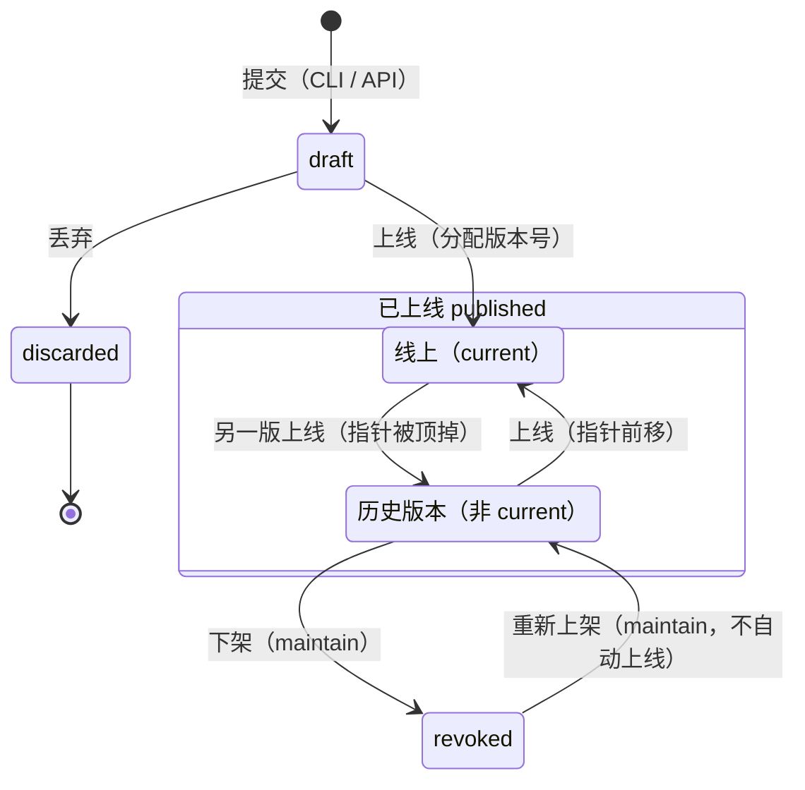

# v6-version-management · 产品需求

> **最后更新**：2026-10-20
> **所属版本**：[`README.md`](README.md)

<!--
这是本版需求的权威文档。README 只放摘要，别处不要重复这里的内容。
-->

## 用户与场景

**谁在用**：两类人，站在同一版的两端。

- **作者**：写 `SKILL.md`、用 `skill submit` 提交、在控制台点上线的人。
- **调用者**：拿凭据读这个 skill 的人或 agent——他可能是作者自己的 agent，也可能是被授了档位的同事。

**在什么场景下用**：四件今天做不到的事，不是四个愿望，是四条今天就撞得到的墙：

1. **作者说得出「这一版改了什么」，但产品里没有地方放。**
   版本表的那一列叫「说明」，读的却是 `skill_version.title`——它来自 `SKILL.md` 的 frontmatter，各版通常一样（标题没变），于是这一列等于没有说明。作者只能在聊天里、在提交信息里说改了什么，产品里不留痕迹。设计件自己记着这件事：`design/README.md` 的「每个版本的说明」一条写明这一列是前瞻性字段，而 `skill_version.changelog` 从 v1 起就存在、注释写着「v1 has no endpoint that sets it」——**位置早就留好了，只是没有入口**。
   **这句话通常由 agent 来写**（它知道自己改了什么），但人也要能在前端补上或改掉——不是每个版本都经过 agent，也不是每次 agent 都写得清楚。所以本版是**双入口、一个主一个次**：agent 在提交时写，人在前端草稿行上补填或修改。

2. **作者要决定版本号，而普通人不知道 MAJOR / MINOR / PATCH 该动哪一位；更糟的是，这个决定发生在开发的时候。**
   今天版本号是作者在 `SKILL.md` 里声明的 semver（[ADR 0033](../../decisions/0033-version-names-are-semver.md)），**提交时就写进地址**；草稿因此也占掉一个正式号，丢弃了也退不回来。而发布那一刻——真正决定「这一版对外叫什么」的时候——反而没有入口。普通人常见的做法是「永远 +1 patch」，或随手填一个更大的数；而版本号对调用者是**唯一**的兼容性信号。

3. **调用者拿到的版本列表只有名字、摘要和时间，看不出两版差什么。**
   `GET /api/v1/skills/{ns}/{name}/versions` 今天只给 `name` / `digest` / `publishedAt` / `isCurrent`（`SkillVersionsResponse.java:46` 的 `Version`）。作者面的版本行有 `title`，消费面没有；调用者要么自己读两份内容做 diff（消费面没有 diff，diff 只在作者面），要么去问作者。

4. **想让一个旧版本退役，却只有两个极端。**
   今天能做的只有「把指针移到另一版」（钉住旧版的人什么都不知道）或「把整个 skill 删掉」（连新版本一起没了，所有地址 404）。中间那件事——**这个版本别再用了，但它还能读**——没有。安全事件里更糟：一个版本泄了密或被投毒，作者没有办法只让它一个人消失，而不打断整个 skill、也不删掉所有版本。

**现在的替代做法是什么**：第 1 条——在聊天里说，或把说明塞进提交信息，产品里看不到；第 2 条——永远 +1 patch，版本号退化成计数器；第 3 条——调用者盲升、永远钉死，或去产品外面问；第 4 条——要么不动，要么把整个 skill 删掉，没有一个只针对旧版本的动作。四条替代做法的共同点是：**版本这个对象本身没有说清楚自己**。

## 范围

### 做

| # | 做什么 | 交付形态 |
|---|---|---|
| 0 | **每个版本有必填的名称；正式版本号在发布时才分配——名称与版本号是两个概念**：版本名称（字段 `draft_name`）是**作者面的名字**（1–40 个 Unicode 码点，中文、英文、数字、符号都可以；不进地址、不进 digest、消费面看不到），提交时必须给，草稿期与发布后都叫「名称」；版本号（`@1.2.3`）在发布那一刻才分配，调用者用它寻址；`SKILL.md` 的 `version:` 不再作准；丢弃草稿**不烧号** | 提交接口新增必填 `name`；提交不再写 `skill_version.version`；草稿的稳定地址是 `draft:<id>`（内容摘要不是草稿地址）；发布接口接收 `release_name` 并按 semver 校验；`UNIQUE(skill_id, version)` 照旧约束非空值；CLI 提交不再读 `version:` |
| 1 | **每个版本有一句自由说明（description，不是名字）**：**主路径**是提交方在 `skill submit` 时提供；**次路径**是人在前端草稿行上补填或修改；不参与内容、不进 digest；作者面版本表下方的说明读它 | 服务端：复用 `skill_version.changelog`（v1 起就存在、从未被写过的自由文本列）+ 提交接口多一个可选字段 + 一条草稿说明的写接口；CLI：`skill submit --note`（可选参数）；网页：草稿行可填可改，版本表下方的说明改读它 |
| 2 | **草稿期可以改名字与说明，发布后冻结**：版本名称与说明在前端看得见；人可以在草稿单版页上改名、改说明；**发布时不再编辑说明**——发布请求只带版本号（`release_name`），说明保持草稿期最后那句，随发布冻结；上线后两者都不能再改；**名称不消失**，发布后仍是这一版在作者面的名字（版本表、单版页标题、版本下拉——下拉可按名称或版本号搜到这一版） | 名称与说明的写接口只在 `draft` 上可用（`write` ∧ 提交人是我，或 `maintain` 及以上）；发布接口只接收 `release_name`（带 `note` → 400 `invalid_request`）；`draft → published` 之后没有写入口 |
| 3 | **调用者的版本列表带上这句说明**：每一版都能回答「改了什么」，而不只有版本号与时间 | `GET /api/v1/skills/{ns}/{name}/versions` 的 `Version` 多一个可空的 `note` 与派生的 `state` / `status`；旧字段一个不动 |
| 4 | **公布 skill 的版本号规范**：MAJOR / MINOR / PATCH 按「调用契约」定义——什么算不兼容、什么算新增、什么算修正 | 常驻权威进 [`architecture/model.md`](../../architecture/model.md)；版本 tab 的单版页按 `design/` 的文案解释它；服务端不推断、界面不额外打标 |
| 5 | **发布时用大白话选版本号**：不问「你要 MAJOR 还是 PATCH」，问「这次改动会影响旧的调用吗」——作者只回答旧调用会不会坏，三选一各自写清后果；根据当前线上版本算出建议号，发布人可以改；按下上线先弹窗确认（名称与说明在此刻锁定），确认后**这一刻**才把号分配给这一版 | 网页的版本 tab 的单版页：显示当前线上版本、建议号、规范摘要与说明，上线动作在页面上执行；按下按钮弹出确认弹窗，确认后才提交发布请求；提交端不再选号、不再改 `SKILL.md` |
| 6 | **历史版本只有一种**：所有已发布、非当前的版本都可读，不再区分「已弃用」；没有弃用 / 取消弃用动作，消费面也不返回弃用信号 | 不引入 `deprecated` 状态，也不加弃用 / 取消弃用两条路由（代码里从未有过）；消费面读过滤是 `published`（含历史版本），响应不带 `Deprecation` 头 |
| 7 | **下架一个非当前版本**：让它对**消费面**不可读；**原因选填**（写了才存、才显示）；留审计；可以重新上架。**当前版本不能直接下架**：先回滚到另一版，让它成为历史版本，再下架；没有安全版本可回滚时，用 skill 级下线停服 | 版本状态加 `revoked`（界面叫「已下架」）；两条 `maintain` 及以上的写路由（下架 / 重新上架）；下架的目标不能是当前版本；作者面 `maintain` 及以上仍能看到这一行，写了原因也看得到 |
| 8 | **历史调用的承诺**：所有已发布的版本**永久可读**（按 `@版本` 或 `@sha256:` 钉）；版本级只有下架会让钉住的调用失败（410）；skill 级下线返回 503 `skill_offline`、skill 删除后返回 404，是另外两件事；版本号永不复用 | 消费面读过滤与版本列表；文档写进 [`architecture/model.md`](../../architecture/model.md)；`UNIQUE(skill_id, version)` 不变 |
| 9 | **作者面的生命周期动作**：版本 tab 是唯一清单；每一版有自己的单版页（地址钉住一版时，清单换成那一版），**所有改变版本状态的操作——改名、改说明、丢弃、上线、下架、重新上架——都在那一版自己的单版页上执行**；清单只负责导航（**行内**不画下载/复制/查看差异这类只读动作；只读入口只在「更多操作」菜单里：查看文件 / 查看改动），点入口不改变任何状态；**每一行整行可点**——名称是唯一的真链接，它的 `::after` 铺满整行，悬停整行高亮；**每行右上角的「更多操作」也只给链接**（查看文件 / 查看改动 / 该状态下可做的动作），按下去到那一版自己的页面，菜单自己不执行任何动作（见验收 #26）。**清单上面是工具栏**：状态过滤（带计数）、搜索（名称 / 版本号 / 说明 / 提交人），两者叠加并写进地址；「新建版本」在本版只是占位，按下不跳转（创建与编辑版本在下一个版本做，§不做 #10）。**六档各看一面**：调用与浏览只看得到可读的版本、没有「新建版本」、调用连行菜单都没有；**调用者的身份是版本号**——列表行、单版页标题与面包屑都用 `@1.2.3`，不出现作者起的名称与提交人，版本事实只留消费契约里的四项（版本号 / 状态 / 首次上线 / 地址）；写入看得到草稿，但「丢弃」只在本人提交的草稿上；维护及以上看到全部（含已下架）与全部入口（见验收 #27）。下架与重新上架要 `maintain`；只有下线 skill 是所有者 | 网页在版本 tab 内增加单版页（读作者面已有的版本数据，不新增接口）；**单版页分成「概览」「改动」与「操作」三栏**：说明与时间线在概览（阅读；草稿的名称与说明在标题与说明上就地编辑，不另开动作块），逐文件差异在改动（文件树 + 每个文件一块，可单独折叠），状态变更动作在操作（普通动作在上、危险操作在页底）；没有基线时没有改动栏，没有可做的动作时没有操作栏；**单版页的差异默认对照上一版**（按 `first_published_at` 排序的前一版，与回滚默认目标同一个顺序；草稿与第一版没有上一版，退回当前线上）；**用户可以选任何这个档位看得见的版本对照**，包括尚未上线的草稿，选择进地址（`from=`）；**增行浅绿、减行浅红**；**草稿单版页上的改名、编辑说明与丢弃**；清单只保留导航（今天没有行内只读动作）；**单版页页头的次级入口「查看文件」跳到文件栏并带着这一版的版本钉**（调用档没有文件栏，不画；草稿只对 `write` 及以上画）；**文件栏的提交行右端写着这一版的名称与版本号，点它回到这一版的页面**——与「查看文件」互为镜像，时间仍是时间、不跟着可点；`design/` 补出单版页、版本名称列、「已下架」状态，以及清单的过滤 / 搜索 / 新建版本占位 |
| 10 | **回滚**：在**当前版本**的页面上选另一版回滚，默认按发布顺序的上一版；目标只可以是历史版本，选项同样是「名称 + 版本号 + 历史版本 tag」（三处版本下拉同一张面孔）；版本多时可以按名称或版本号筛；不新建版本、不改版本号；回滚**不拿走任何东西**（每一版都还在，只是线上指针移动），所以它不是危险动作、不进危险区：入口在单版页的「操作」，但**仍要弹窗确认**（确认钮不染红） | 单版页「操作」+ 版本选择器 + 确认弹窗；底层仍是「上线到另一版」，不新增发布路由；`design/` 补动作块与选择器 |
| 11 | **skill 级下线 / 恢复服务**：整个 skill 停止服务，消费面所有读返回 503 `skill_offline`；版本状态与指针不变；恢复服务不需要重新上线；仅所有者，放在设置页的危险区域；作者面与「我的 skill」标「已下线」；搜索不返回 | `skill.offline_at`（或等价的服务开关）+ 两条 Web 路由 + 消费面 503 + 作者面 badge + 搜索过滤 + 审计；`design/` 补设置页危险区与「已下线」状态 |
| 12 | **大改动的改动页照样打得开**：改动页先回来的是**文件清单**（路径、状态与逐文件的行数），文件内容按文件、按段加载；单个文件首屏只画前 400 行，之后每次多 500 行；文件超过 100 个时一次只展开一个文件，配上一个 / 下一个；任何被截断的地方都说清原因与出路，不把半份差异伪装成全部 | 接口：`GET …/diff` 在超过预算时只回文件清单 + `next`，内容按批取（每批 20 个文件 / 5,000 行）；单文件超过 5,000 行或 256 KB 时**不进 diff**（`hunks` 为空），页面画「这个文件太大，没有展开」；服务端有界缓存 + `ETag`；网页与 `design/` 补懒加载、单文件模式、「只看文件列表」、二进制 / 超限 / 未取 / 加载中 / 失败五态；单次响应的 `max-lines` 降到 5,000 |
| 13 | **版本管理的 CLI 面（agent 用）**：agent 手里的凭据能**查看**这个 skill 的全部版本（含草稿、已下架、已丢弃，按档位过滤）、读一版的事实与改动、读草稿的文件；能**管理草稿**——改名、改说明、丢弃；提交仍是 `skill submit`。**改变调用者读到什么的动作一律不在 CLI**：上线 / 回滚 / 下架 / 重新上架 / 整 skill 下线 / 恢复服务 / 删除只能在网页上由人确认（[ADR 0031](../../decisions/0031-submitting-and-publishing-are-two-actions.md)、[0046](../../decisions/0046-deleting-a-skill-happens-in-the-browser.md)、[0061](../../decisions/0061-what-a-credential-may-do-to-versions.md)）；CLI 对这些动词只给一句拒绝与 `version open` 的完整命令。机器可读输出统一 `--json`；写命令必须写明是哪一版，`discard` 还要 `--yes`（[ADR 0061](../../decisions/0061-what-a-credential-may-do-to-versions.md)） | 服务端：作者面 API `/api/v1/author/skills/{ns}/{name}/…`（Bearer + scope + 同一梯子）；CLI：`version list / show / diff / rename / note / discard / open`，`skill files` / `skill read` 接受草稿与已下架的钉；第一方同意屏（`/cli-sign-in`）`skills:write` 那一句改为「以你的身份提交新版本、管理草稿与共享」 |

**第 0 条是这一版的底座。** 它把**版本名称**与**版本号**分开：每个版本有一个必填的名称（作者面用来认这一版，例如「compress 补文档」）和一句自由说明；正式版本号在发布那一刻才贴上去。**名称与版本号不是同一个概念**：名称是作者给这一版起的名字，发布后也不改、不消失；版本号是上线时分配、调用者用来寻址的那一个。名称不是命名空间——不进地址、不进 digest、消费面永远看不到；草稿的地址身份仍是稳定的 `draft:<id>`。`SKILL.md` 里的 `version:` 从本版起**不再作准**——它仍然是内容的一部分（原样透传），但不是地址里的那个号。代价写在 §不做 与 ADR 里：文件与地址可能不一致，这是有意的取舍。

**名称是 name，说明是 description，两者不能互相兼任。** 版本名称短、必填、用来指代「是哪一版」；说明长、可选、回答「这一版改了什么」。名称在发布后不消失：**单版页的标题一直是名称**，上线时分配的版本号是名称旁的一枚等宽标识；版本表的每行上方把名称、版本号与状态放在同一段，版本下拉是「名称 + 版本号 + 状态」。这样作者还能认出「这是当时那条『compress 补文档』」，调用者仍按 `@1.2.3` 寻址；消费面只看得到版本号与公开说明。名称与说明都**不能**进内容：同一份字节配不同的名称或说明，仍然是同一个版本，否则「改个名字」就会变成「发一个新版」。

**「人在前端填」不等于「人在前端造版本」。** 本版版本内容仍然只从 CLI / API 提交进来（[ADR 0031](../../decisions/0031-submitting-and-publishing-are-two-actions.md)）；网页不出现上传 zip 的按钮。人能做的是**给已有的草稿改名、补一句说明**，以及在版本 tab 的单版页上确认它——这与网页今天的职责一致：它是看和确认的地方，不是提交的地方。内容编辑是后续版本的能力（§不做 #10）。

**所有改变版本状态的动作都不在列表上一键生效。** 改名、改说明、丢弃、上线、下架、重新上架都在那一版自己的单版页上；当前版本的回滚在单版页的「操作」栏；历史版本的下架在单版页底部的危险区；整个 skill 的下线在设置页的危险区域。**危险动作（下架、下线 / 恢复服务、删除）一律弹窗确认**。回滚、上线草稿与丢弃草稿也走同一个弹窗但不当危险动作处理——**丢弃草稿不影响线上**（消费面读不到草稿，指针也不动），所以它不进危险区、按钮描边不染红，排在「操作」的动作流里；但它**无法找回**，弹窗正文第一句必须这么说（[ADR 0060](../../decisions/0060-discarding-a-draft-is-not-dangerous.md)）。上线草稿的弹窗要说清「名称与说明在这一刻锁定，调用者会读到它们，上线后不能再改」（确认钮不染红；等待、成功、失败都在同一张弹窗里）。版本表只负责导航（下载/复制/查看差异这类行内只读动作是将来扩展，今天不画）；点入口不改变任何状态。

**「测试」这一版只做到作者面。** 产品不执行 skill（[ADR 0008](../../decisions/0008-no-script-execution.md)）；`write` 及以上能读草稿、看 diff，这就是产品能提供的全部验证面。要让**非作者**在发布前读到或调用草稿，需要按版本的预览授权或预发布通道——它们是另一套能力（§不做 #11），本版不顺手做。把这条边界写清楚，比在版本状态机里塞一个没有执行能力的「测试中」状态诚实。

**第 4 条是这一版最容易被做成文案、而没做成规则的地方。** 规范不是一句提示语，而是三条**可判定的定义**（见 §验收 #6 与 [`architecture/model.md`](../../architecture/model.md)）；界面引用它，服务端不执行它。服务端一旦按 diff 猜 MAJOR，就把「作者的声明」降级成「工具的猜测」，而 [ADR 0033](../../decisions/0033-version-names-are-semver.md) 的理由正是「伪造的 semver 比诚实的计数器更坏」。

**第 6–11 条是版本生命周期与服务开关的另一半。** 第 0–5 条回答「这一版说了什么」；第 6–9 条回答「它什么时候不再推荐、什么时候不可读、谁有权这么做」；第 10 条回答「怎么退回上一版」；第 11 条回答「怎么让整个 skill 暂时停服」。版本级动作共用同一个版本行与同一条指针；skill 下线是另一层，只影响服务，不改版本状态。

**第 12 条是改动页的加载边界。** 卡顿通常不是「差异太大」四个字造成的，而是**把整份差异一次算完、一次发完、一次画完**：[GitHub](https://docs.github.com/en/repositories/creating-and-managing-repositories/repository-limits) 对单文件只自动加载前 400 行、整份 diff 最多 300 个文件（2025-09 起 UI 到 1,000，并给多文件的比较自动切到[单文件模式](https://github.blog/changelog/2025-09-11-pull-request-files-changed-public-preview-experience-september-11-updates/)）；[GitLab](https://docs.gitlab.com/administration/diff_limits/) 在 100 个文件 / 5,000 行 / 500 KB 处默认折叠，超过 1,000 个文件 / 50,000 行直接不渲染。我们照同一条原则做：**清单先到、内容按需、单文件分段**，并且服务端只算被请求的那一批。不可逆的事实沿用同一条老规矩——截断要说出来，不能假装那就是全部。
### 不做

| # | 不做什么 | 为什么 | 什么时候可能做 |
|---|---|---|---|
| 1 | **分支 / 并行开发线 / 合并** | 产品是**单线**：[`architecture/model.md`](../../architecture/model.md) 写着「git 是 DAG，这里是单线……没有别的分支」。分支不是命名问题，它要回答合并、冲突、两条线各自怎么发布、地址怎么钉——是另一套语义，另一个版本 | 未定；若要做，先开 ADR |
| 2 | **可变工作区**（产品里有一个能一直编辑的目录） | 工作区在本地；产品接收**提交后的草稿**，草稿可编辑（本版只开放说明，内容编辑见本表 #10），但产品里没有一个能一直编辑的目录/工作区；**发布后的版本才是不可变快照**（[ADR 0031](../../decisions/0031-submitting-and-publishing-are-two-actions.md) §背景）。把工作区搬进产品会推翻内容寻址与「提交即快照」的前提 | 未定；体量远大于本版 |
| 3 | **给已经发布的版本改名** | 名字分配一次、之后不可改；改一个已对外发出的名字，会让钉住它的调用者看到两件事。要换号就发一个新版本 | 不做（结构性） |
| 4 | **上线后修改说明** | 公开说明是调用者读到的事实；随版本冻结，调用者的记录不会在背后变。要改就发下一版 | 不做（结构性） |
| 5 | **服务端推断版本号**（按 diff、文件数、改名自动判定 MAJOR / MINOR / PATCH） | 服务端无法知道一次改动是不是破坏性的（[ADR 0033](../../decisions/0033-version-names-are-semver.md) §理由）；启发式会误判，且会毁掉版本号作为「作者声明」的可信度 | 不做（结构性） |
| 6 | **完整 changelog / 多条变更记录 / 富文本** | 本版只回答「这一版改了什么」一句话；多条记录要另一个界面与另一套存储，没有需求驱动 | 未定 |
| 7 | **版本删除**（把行与字节物理删掉） | 这一版做的是**下架**：状态变成消费面不可读，行与字节都留着，审计与恢复都还在。物理删除会让「谁在什么时候拿走过什么」失去证据，也没有需求驱动 | 未定 |
| 8 | **消费面的 diff** | diff 是作者面的读法（[ADR 0031](../../decisions/0031-submitting-and-publishing-are-two-actions.md) §后果）；消费面要回答「值不值得升」，一句说明加版本号含义已经够 | 未定 |
| 9 | **说明进搜索 / 进列表排序** | 它是版本的元数据，不是 skill 的元数据；搜索的权威在 `skill` 行与 `skill_version` 的投影，混进版本说明会让「搜到什么」随版本变 | 不做 |
| 10 | **本版不做网页端内容编辑**（上传 zip、在线编辑正文），**也不做「新建版本」** | 本版只开放说明编辑；内容编辑要处理上传/编辑、并发、草稿摘要与发布冻结，是独立能力。草稿身份已预留稳定 id（`draft:<id>`），后续版本实现时不需要迁移；本版内容仍由 CLI / API 提交。版本列表上的「新建版本」**只是占位**：按下不跳转，避免页面缺一个读者会找的入口，又不假装这个能力已经存在（2026-10-20 定） | 下一个版本（创建与编辑版本一起做） |
| 11 | **测试面**（按版本的预览授权、预发布通道） | 产品不执行 skill（[ADR 0008](../../decisions/0008-no-script-execution.md)）；测试在本地 + 作者面读草稿与 diff。要让非作者在发布前读到或调用草稿，需要按版本的预览授权或通道语法，是另一套能力 | 未定 |
| 12 | **计划中的版本对象**（未提交的「开发中 2.0」） | 版本从**提交**那一刻开始；一个未提交的计划对象是进度/路线图，不是版本快照。它要自己的状态与界面，与版本状态机是两件事 | 未定 |
| 13 | **自动下线 skill / 定时下线 skill** | 下线 skill 改变调用者能读到什么，必须是人的显式动作；定时需要一个调度面，本产品还没有 | 未定 |
| 14 | **继续把 `SKILL.md` 的 `version:` 当作版本号** | 本版把它改成发布时分配（做 #0）；文件里的字段不再作准。要保留旧语义就回到 [ADR 0033](../../decisions/0033-version-names-are-semver.md)，但那样草稿会继续烧号 | 不做（结构性） |
| 15 | **在界面上标「试用」**（给 `0.y.z` 再加一枚章） | `0.y.z` 在 SemVer 里的含义不变，但界面不另标：它没有对应的动作或权限，一枚章只会多一个要解释的词，调用者读到的仍是版本号本身（2026-10-20 定） | 若将来消费面需要按稳定性分流（例如只推荐 `1.x`）时再开一条显示规则 |
| 16 | **把生成文件 / 第三方产物自动折叠**（类似 GitHub 的 `linguist-generated`） | skill 包没有 `.gitattributes` 这样的标记面；自动猜生成文件会误伤正常内容。这一版用「按需加载」把成本压下去，不引入一条作者要维护的标注约定 | 如果真实数据里生成文件占比很高，再设计一个包内标记 |

**范围里不许出现「后续再看」「视情况而定」。** 不确定的进 [`technical-design.md`](technical-design.md) §开放问题，并且必须是一个**能回答的问法**。

## 版本状态与状态转移

这一节是版本生命周期在**产品上**的权威：一个版本有哪几种状态、每种状态能做什么、做完之后去哪里。存储与读取上的落点（枚举、约束、`findCurrent`、三处读过滤）在 [`technical-design.md`](technical-design.md) §版本状态机；skill 级服务开关与 `offline_at` 在 TD §skill 级服务开关，不在这里重复。

### 五个状态，四个存储状态

版本在**产品与分析上**有五个状态；其中「线上」与「历史版本」在库里共用 `published`，由 `skill.current_version_id` 区分。存储只有四个值——不把指针复制成第二个状态。

| 状态 | 存储状态 | 什么时候是这个名字 | 有版本号吗 | 名称 |
|---|---|---|---|---|
| **草稿** | `draft` | 提交了，还没上线 | 没有 | **有（必填）**，作者面标签 |
| **线上** | `published` + 指针 | 已上线，且 `current_version_id` 指着它 | 有 | 保留，作者面与版本号分开展示 |
| **历史版本** | `published` + 无指针 | 已上线，但不是当前线上版本 | 有 | 保留 |
| **已下架** | `revoked` | 被 `maintain` 及以上从消费面下架 | 有 | 保留 |
| **已丢弃** | `discarded` | 草稿被丢弃，从未上线 | 没有 | 保留在行上（作者面可见时） |

**五个状态是产品与分析口径；存储只有四个值。** 线上与历史版本在库里都是 `published`，由指针区分。读模型提供派生的 **`status`**（`draft` / `live` / `history` / `revoked` / `discarded`），由 `state + isCurrent` 算出来；数据库不新增列，分析直接按 `status` 分组，也不需要同时维护「状态」和「指针」两份事实。

### 每个状态能做什么

| 状态 | 消费面读得到吗 | 作者面谁看得见 | 能做的动作（谁能做） | 做完之后 |
|---|---|---|---|---|
| **草稿** | 不能；消费面不列。按路径钉住是 404；把 `draft:<id>` 塞进 `X-Skill-Version` 是 400（那不是消费面的钉形式） | `write` 看全部草稿（别人的只读）；`maintain` 及以上看全部 | **改名**（`write` ∧ 提交人是我，或 `maintain`+）；**编辑说明**（同上；内容编辑预留）；**上线**（`maintain`）；**丢弃**（`maintain`，或 `write` ∧ 提交人是我） | 改名与改说明不改变状态与草稿地址；上线 → 线上（**这一刻**冻成快照、分配版本号，指针前移）；丢弃 → 已丢弃（不占发布号） |
| **线上** | 能 | 作者面原有的读档位 | **回滚**（`maintain`；选另一版，默认按发布顺序的上一版）；**下线整个 skill**（仅所有者；skill 级，见下）；说明已冻结；**不能直接下架**（见不变量 2） | 回滚 → 所选版本变成线上，原线上变成历史版本；下线 skill → skill 停止服务，这一版仍是线上 |
| **历史版本** | 能 | 作者面原有的读档位 | **上线**（`maintain`，指针前移）；**下架**（`maintain`）；说明已冻结 | 上线 → 线上；下架 → 已下架 |
| **已下架** | 不能；**410 `version_revoked`** | `maintain` 及以上（写了原因就能读到） | **重新上架**（`maintain`） | 历史版本（回到 `published`，**不自动上线**）；要对外，再点一次上线 |
| **已丢弃** | 不能；404 | `maintain` 及以上（与已下架同档）；**没有入口菜单**，按钉打得到只读单版页；`write` 及以下打不开 | 无（终态） | — |

**草稿是可编辑的。** 名字、说明和内容都属于草稿；本版开放改名与说明编辑，内容编辑（网页改文件/正文）是预留能力，不在本版实现。草稿有稳定身份 `draft:<id>`，内容摘要只是它的一个字段——编辑内容不会改变草稿地址。**发布后的版本才是不可变快照**，身份仍是内容摘要与版本号；名称冻结，但它仍是这一版在作者面的名字，标题上一直显示，版本号跟在旁边。

**回滚不是又一个生命周期动作。** 它是从当前版本页发起的「上线到另一版」：不新建版本、不改版本号；目标只能是历史版本，已下架/草稿/已丢弃不可选。默认选按 `first_published_at` 倒序、当前版本下面那一版；没有可选的上一版时，必须手动选。**当前版本不能直接下架**：它必须先被回滚成历史版本，才能下架。

**下线整个 skill 是 skill 级动作，不在版本状态机里。** 它不改变任何版本的状态；见 §skill 级：下线与恢复服务。

**权限的两条边界**：**版本级的下架与重新上架要 `maintain` 及以上**——它们改变消费面能读到什么，但 `maintain` 已经在管上线，下架一个版本不再单独抬到所有者；**只有下线整个 skill 是所有者专属**，它停的是整个服务，与删除 skill 同档。`browse` / `invoke` 看不到草稿与已下架的行，也看不到任何生命周期入口。

**动作在哪里发生**：**所有改变版本状态的操作都在那一版自己的单版页上**——草稿的改名、改说明与丢弃、上线、下架、重新上架；当前版本的回滚在单版页的「操作」栏（回滚不拿走东西，不进危险区，但仍弹窗确认）；丢弃草稿也只在作者面结束这一版、不影响线上，所以同样不进危险区（弹窗确认，正文说清这一版无法找回）；历史版本的下架在单版页底部的危险区；skill 下线在设置页的危险区域。**清单只负责导航**（下载/复制/查看差异这类行内只读动作是将来扩展，今天不画），导航不改变任何调用者读到的东西（内容编辑不在本版；[ADR 0054](../../decisions/0054-lifecycle-actions-happen-on-a-version-page.md)、范围 #10）。

### 状态转移图

**回滚不新增一条边。** 它就是 `历史版本` → `线上` 的那条上线，只是入口在当前版本页；不改版本号，也不新建版本。**线上没有下架边**：当前版本必须先回滚成历史版本，才能下架。

### 四条不变量

1. **`current_version_id` 只能指向 `published`。** 所以「下架当前版本」不是合法动作：先上线或回滚替代版本、让指针前移，旧的变成历史版本，再下架它。
2. **指针只由上线 / 回滚移动，不会被下架清空。** 一个有已上线版本的 skill 始终有一个当前版本。只有从未上线过（只有草稿）时 `current_version_id` 才是 NULL：裸地址没有服务，作者面的默认屏幕落回最新一个未被丢弃、未被下架的版本。
3. **版本号永不复用。** 丢弃不烧号（草稿本来就没有版本号）；下架不释放号（行与字节都留着）；重新上架后还是同一行、同一个号。同号不同内容在发布时被 `version_already_exists` 拒绝。
4. **所有已发布的版本永久可读。** 按 `@版本` 或 `@sha256:` 钉住的读不会因为新版本上线而失效；版本级只有下架会报 410（skill 级下线 503、skill 删除后 404，是另外两件事）。草稿与已丢弃在消费面不存在：按路径钉住是 404；`X-Skill-Version: draft:<id>` 是 400——那不是消费面的钉形式（`VersionHeaderException` 的规矩），不是「找不到」。

**说明跟着状态走**：草稿期可写（agent 在提交时写，人在草稿行上补填或修改）；上线时确认最终值；上线后冻结——已上线与已下架的版本都没有写说明的入口。

### skill 级：下线与恢复服务

**这是 skill 的服务开关，不是版本的状态。** 下线后版本仍然保留（线上仍然是线上、历史版本仍然是历史版本），但消费面不再提供服务。

| 动作 | 谁能做 | 在哪 | 后果 |
|---|---|---|---|
| **下线 skill** | 仅所有者 | 设置页的危险区域 | 所有**能看见这个 skill 的**消费面读（含按版本/摘要钉住的）返回 **503 `skill_offline`**；看不见的仍 404（不泄露存在性）；搜索与公开列表不返回；作者面照常管理；版本状态与指针不变 |
| **恢复服务** | 仅所有者 | 同上 | 当前线上版本重新对外服务；**不需要重新上线**；若没有当前版本，裸地址仍然没有服务 |

- **错误与文案**：HTTP **503 `skill_offline`**；界面文案「这个 skill 已下线，暂时不提供服务。」
- **作者面不动**：文件、版本、设置都照常可读可管理；页头与「我的 skill」标「已下线」，并给一条去设置页恢复的路。
- **搜索与公开列表**：下线后不出现；「我的 skill」仍列出，标「已下线」。
- **审计**：下线与恢复各写一条（`skill_offline` / `skill_online`），含操作者、目标 skill、时间。
- **下线 ≠ 下架 ≠ 删除**：下架拿掉一个版本；下线停掉整个 skill 但保留所有版本；删除把 skill 放进「已删除」。
- **当前版本出问题时**：先回滚到一个安全版本，再下架旧版本；没有安全版本可回滚时，用「下线 skill」停服，发布替代版本后再下架。**当前版本不能直接下架。**
- **恢复不会自动选一个当前版本**：如果一个 skill 从未上线过（只有草稿），下线再恢复后仍然没有当前版本；要对外，先上线一版。

## 验收与指标

### 验收标准

每条都必须是**能判定过没过**的。

| # | 验收标准 | 怎么判定 |
|---|---|---|
| 1 | **说明不参与身份**：同一份内容配两句不同的说明提交，digest 不变、版本数不增加；地址与 `@版本` 的解析完全不变 | 提交同一份 zip 两次、两次带不同的 `note`：第二次返回 200（不是 201），`digest` 与第一次相同、`draftId` 也相同，`skill_version` 行数不变；作者面按 `draft:<id>` 读到的是同一份内容（草稿在消费面不可读，这是有意的）；库里那行的说明仍是第一次写入的那句（幂等提交不覆盖） |
| 2 | **agent 写得出说明，不带也能提交**：`skill submit --note "…"` 成功并在提交响应里读回；不带 `--note` 的提交仍成功，说明为空 | CLI 跑两次；API 用 multipart 的 `note` 部分各跑一次；响应里的 `note` 与提交时给的一致；TD 已定：空说明返回 `null` |
| 3 | **作者面版本表读的是这句说明，不是 frontmatter 的 `title`** | 提交时让 frontmatter 的 `title` 与 `note` 取两个不同的值；网页版本表下方的说明必须显示 `note`；草稿行与已上线行都验 |
| 4 | **草稿期可改、发布后冻结**：草稿行上的说明能被有权限的人改；版本 tab 的单版页显示当前那句；**发布不改说明**，上线之后任何写入口都改不了它 | 草稿期连改两次，作者面读到最后一次；发布请求不带 `note`；上线后作者面与消费面读到的都是草稿期最后那句；发布请求带 `note` → 400 `invalid_request`；对已上线版本调草稿说明接口 → 400 `note_is_frozen` |
| 5 | **调用者看得到说明**：`GET …/versions` 的每一版多一个可空 `note` 与派生的 `state` / `status`；旧字段一个不变 | 发布两版、给不同说明；用 `invoke` 档的凭据读版本列表，两行各自带自己的 `note`；没有说明的版本该项为 `null`；旧客户端忽略新字段仍能解析 |
| 6 | **规范是可判定的三条定义，不是一句口号**：MAJOR 指调用契约的不兼容变化，MINOR 指旧调用不受影响的新增，PATCH 指接口与行为不变的修正 | 读 [`architecture/model.md`](../../architecture/model.md) 那一节，三条定义各自有「什么算、什么不算」；网页版本 tab 的单版页引用的是同一套定义；版本 `0.3.0` 与 `1.2.3` 在界面上只差版本号本身，不带额外的稳定性章（§不做 #15） |
| 7 | **服务端只校验形状，不猜含义**：非法版本号在发布时 400；同号不同内容在发布时 400 `version_already_exists`；一次看起来像 MAJOR 的改动在版本 tab 的单版页里选 PATCH 仍然被接受 | 三组请求各跑一遍；第三组必须成功——服务端没有资格判断这次改动是不是破坏性的；响应里没有任何由 diff 推断出来的字段 |
| 8 | **草稿的说明不泄露**：消费面的任何响应里都看不到草稿的说明或草稿行 | 建一个有草稿的 skill，用 `invoke` 档凭据读版本列表与详情；版本列表里没有草稿行，`note` 只出现在已上线版本上；草稿的说明不出现在任何消费面 JSON 里 |
| 9 | **旧客户端的读不受影响；提交必须升级**：不读 `note` / `draftName` 的读方照旧工作；v6 之前的客户端不带名称提交 → 400 `draft_name_required`，升级 CLI 后成功 | 用 v6 之前的 CLI 读列表：解析成功、新字段被忽略；用旧 CLI 提交：400 且错误消息说清缺什么；升级后的 CLI 用同一个仓库提交：成功 |
| 10 | **说明不进搜索**：关键词只出现在某版的说明里、不出现在 title / description / 正文里时，搜索找不到这个 skill | 建这样一个版本并发布；按那个关键词搜，结果为空；把同一个词放进 description 再搜，结果出现——证明不是搜索坏了 |
| 11 | **人在前端改得动名字与说明，但不能越权**：`write` 能在**草稿的单版页**上改**自己提交的**名字与说明；改别人的草稿要 `maintain` 及以上；`browse` / `invoke` 看不到草稿行、也没有入口；已上线的版本没有编辑入口 | 用五档凭据各试一次：从草稿行点进单版页，`write` 改名/改说明自己的 → 成功；`write` 改别人的 → **403**（看得见，是这一档不够）；`maintain` 改别人的 → 成功；`browse` → 看不到草稿那一行；对已上线版本 → 没有编辑入口 |
| 12 | **历史版本只有一种**：所有已发布、非当前的版本都可读，没有「已弃用」这个状态；作者面没有弃用 / 取消弃用入口；消费面响应不带 `Deprecation` 头 | 发布 A、B 两版（B 为当前）；A 的页面与版本列表都只写「历史版本」；页面上没有弃用入口；按 A 的两种钉读都 200，响应头没有 `Deprecation`；消费面版本列表仍列出 A、`status=history` |
| 13 | **下架只影响消费面**：下架一个**非当前**版本后，消费面按 `@版本` / `@sha256:` 读都失败（410 `version_revoked`）；作者面 `maintain` 及以上仍看得到这一行，写了原因也看得到，`browse` / `write` 看不到它；消费面版本列表不再列出它 | 用 `invoke` 档凭据读被下架的那一版与列表；作者面用 `maintain` 与 `browse` 各读一次同一版；两边结果按上面逐条对 |
| 14 | **当前版本不能直接下架，指针不会被下架清空**：直接下架当前线上版本 → 400 `invalid_version_state`；先回滚到另一版，原版本成为历史版本后才能下架；下架后 `current_version_id` 仍指向新的当前版本；裸地址继续读到新的当前版本；重新上架只回到历史版本，不自动上线 | 直接下架当前版 → 400；回滚到 1.2.0，再下架 1.3.0（此时是历史版本）→ 成功；读库，`current_version_id` 仍指向 1.2.0；裸地址读到 1.2.0；重新上架 1.3.0 后仍是历史版本，作者要再上线 |
| 15 | **权限分得开**：`maintain` 能下架 / 重新上架；`admin` 也能；只有「下线整个 skill」是所有者；`browse` / `invoke` 看不到这些动作 | 用五档 + 所有者各试一次；`maintain` 下架 → 成功；`admin` 下架 → 成功；`maintain` 重新上架 → 成功；`admin` 下线 skill → 403；所有者下线 → 成功；`browse` / `invoke` 看不到入口 |
| 16 | **版本号不复用**：把 `1.2.3` 回滚成历史版本并下架之后，同号不同内容**可以提交成草稿**（草稿没有版本号），但发布时给它 `1.2.3` → 400 `version_already_exists`；重新上架后仍是同一行、同一号 | 回滚到另一版、下架 1.2.3；提交同号不同内容的草稿；发布时给 1.2.3；再重新上架；核对行与号 |
| 17 | **版本级的两个动作都进审计**：下架、重新上架各写一条审计，含操作者、目标版本、时间；下架那条写了原因就带原因 | 各做一次；审计表按目标版本查得到两条；写了原因时那条审计带原因，没写时也照样成功 |
| 18 | **历史调用按承诺工作**：所有已发布的 `@版本` / `@sha256:` 永久可读；已下架的读失败；重新上架后又可读；整个 skill 下线期间全部 503、删除后全部 404，恢复服务 / 恢复后回来 | 一版已发布、一版已下架；分别读；下线整个 skill 再读（503）；删除整个 skill 再读（404）；恢复后再读 |
| 19 | **版本号与内容身份分开**：提交一个草稿后 `skill_version.version` 为 NULL，作者面用名称指代它（说明另列），地址是稳定的 `draft:<id>`（不是内容摘要）；发布时分配 `1.3.0` 后 `@1.3.0` 才可解析；丢弃这个草稿**不占用** `1.3.0`；同一份内容只产生一行、只能有一个版本号；`SKILL.md` 里写 `version: 9.9.9` 被忽略 | 提交 A（名称「搜索重构」，`SKILL.md` 写 `version: 9.9.9`）：库里 `version` 为 NULL，`@9.9.9` 404，记下它的 `draft:<id>`；改一次说明，地址仍是同一个 `draft:<id>`；丢弃 A；提交 B，发布时分配 `1.3.0`：`@1.3.0` 解析到 B；把 B 的内容原样再提交一次：返回已有版本，不产生第二行、第二个名字；A 没有占用任何发布号 |
| 20 | **改变版本状态的动作不在一键生效**：版本表只负责导航，点下去不改变任何状态；点入口后，清单换成**那一版自己的页面**（不是第二份清单），页面分成「概览」「改动」与「操作」三栏——名称与状态在版本头与状态条，说明与时间线在概览（阅读；草稿的名称与说明就地编辑），逐文件的差异在改动，动作在操作（没有动作时这一栏不画）；**改名、改说明与丢弃也在单版页上，不在列表行内**；页面地址可以发给另一个维护者 | 在版本表上逐个点入口：每次只导航、状态不变；点任一入口后清单收起、单版页出现；**点「改动」切到文件树 + 逐文件差异，地址里带着 `sub=diff`；点「操作」切到动作栏，地址里带着 `sub=actions`；概览里没有生命周期动作控件（草稿的名称与说明是就地编辑，不在动作块里）**；在草稿单版页改一次名字、改一次说明、再丢弃；在单版页上完成一次上线与一次对**历史版本**的下架；把单版页地址复制到另一个会话打开，看到的是同一版；返回回到清单；**打开线上版本页，改动默认对着上一版（选择器停在上一版）并画出改动，不是空白；换成另一版（包括草稿）后地址带着 `from=`，差异随之更新**；`browse` / `invoke` 打开的版本表没有生命周期入口；列表上没有改变状态的动作，行内也不画下载/复制/查看差异（只读入口在「更多操作」菜单里） |
| 21 | **回滚不改版本、不改号**：从当前版本页的「操作」选另一版；默认按发布顺序的上一版；点「回滚」弹出确认弹窗（不染红），确认后所选版本成为线上，原线上成为历史版本；已下架/草稿/已丢弃不可选；`maintain` 可用；按原版本钉住的调用不受影响 | 准备 1.2.0 与 1.3.0（当前）；打开当前版本页，默认选中 1.2.0；点回滚 → 弹窗（取消为默认焦点、确认钮不是红色），确认后裸地址读到 1.2.0、1.3.0 变成历史版本，版本行数不变；按 1.3.0 钉住的读仍 200；`write` 看不到回滚入口；已下架的版本不出现在回滚候选里，选择器只列历史版本 |
| 22 | **下线停整个 skill，不改版本状态**：下线后，对**能看见这个 skill** 的调用者，所有消费面读（含按版本/摘要钉住的）返回 503 `skill_offline`；看不见的仍 404；作者面仍可管理；版本状态与指针不变；恢复服务后当前版本继续服务，不需要重新上线；搜索不返回；仅所有者；审计 | 所有者下线；一个能看见它的 `invoke` 凭据读裸地址与按版本钉住的地址都 503；一个看不见它的凭据仍 404；作者面读版本表，状态与指针不变；搜一次，结果为空；「我的 skill」显示「已下线」；恢复服务后裸地址重新读到当前版本；审计表有下线/恢复两条；`admin` 下线 → 403 |
| 23 | **五个状态有稳定的分析口径**：版本读模型返回派生的 `status`，五值之一；它由 `state + isCurrent` 算出，不落库；作者面与消费面（可见时）对同一版本给出同一个 `status` | 造五种状态各一版（草稿、线上、历史版本、已下架、已丢弃）；读作者面版本列表，逐个核对 `status`；消费面用 `invoke` 读可见的 live/history 版本，`status` 与作者面一致；库里没有 `status` 列 |
| 24 | **版本名称必填，且与说明、版本号是三件东西**：提交时不带名称（multipart 的 `name` 部分；库里是 `draft_name` 列）→ 400 `draft_name_required`；名称不进 digest、不进地址、消费面任何响应都看不到；发布后作者面把名称与版本号**分开展示**；名称在发布后冻结；改名只在草稿单版页 | 提交不带 multipart 的 `name` 部分 → 400；带名称提交成功，响应回显 `draftName`；同一内容两次提交换名称 → 同一行、同一 `draftId`，名称以第一次为准（幂等提交不覆盖）；发布后读作者面：单版页标题是名称、标题旁是版本号，版本表每行上方同时有名称与版本号，版本下拉的选项是「名称 + 版本号 + 状态」并且输入名称或版本号都能筛到它；用 `invoke` 读消费面：没有名称；发布后调改名接口 → 400 `draft_name_is_frozen` |
| 25 | **大改动不把整份东西一次算完、发完、画完，但行数不省**：打开一个 124 个文件的比较时，首屏只有文件树与文件头；**总行数与每个文件的 `+n −m` 随清单一起到**（numstat，不随「内容按需」一起藏起来）；文件体在进入视野或点开时才取；单文件首屏 400 行，「显示更多」每次多 500 行；超过 100 个文件默认单文件模式；「只看文件列表」仍列出全部文件与行数；**文件清单上方有一颗按路径收窄这份清单的筛选框**（右栏已经展开的差异不跟着消失）；二进制、超限与加载失败各有自己的说明，失败态给「重试」；同一对版本再次打开不重算 | 用 124 个文件（含一个 3,200 行文件、一个二进制、一个超限文件）的比较：首屏只有文件树、文件头与当前那一个文件的正文，其余文件体一个都没有；**页签右上角与每个文件头在第一帧就有总行数与 `+/−`（二进制与超限文件是 `—`，不是 `+0 −0`），不出现「行数随加载出现」这类占位句**；当前文件加载后正好 400 行，点一次「显示更多」到 900；切到第 124 个文件只取那一个；「只看文件列表」后正文全部收起、树与行数仍完整；**在清单上方的筛选框里输入一个路径片段 → 只剩匹配的行，右栏不动；筛不到 → 「没有匹配的文件。」+「清除筛选」；值写进地址 `fq=`**；超限文件显示「这个文件太大，没有展开」而不是 `+0 −0`；断网 / 失败态显示原因与「重试」，重试成功后正文出现；同一对版本第二次请求返回 304 或命中缓存 |
| 26 | **列表上面能筛、能搜，但「新建版本」在本版不做事**：状态胶囊带计数、只在出现过的状态上画，计数不随搜索变；筛选与搜索叠加、都写进地址；从列表点进一版再回来，筛选与搜索还在；没有匹配时是一句话加「清除筛选」；**每一行整行可点**（名称是唯一的真链接，`::after` 铺满整行；悬停整行高亮；不给行加 `role="button"`）；**每行右上角的「更多操作」只给链接**——查看文件 / 查看改动 / 该状态下可做的动作，全部去那一版自己的页面，按下去不执行任何动作；「新建版本」按下不跳转、不改地址 | 打开版本列表，「全部」那一枚数的是这一档看得见的全部行；点「草稿」→ 只剩草稿行、地址带 `filter=draft`；搜「compress」→ 行收窄到名称 / 版本号 / 说明 / 提交人含它的那些；「线上」+ 搜一个不存在的词 → 「没有匹配的版本。」+「清除筛选」，点它回到全部；带 `filter=published` 打开一版再点回去，列表仍是「历史版本」；**点一行说明那一块（不是标题）→ 进这一版；悬停任意一行 → 整行压一层底色；Ctrl / 中键点行内任意处 → 新标签页打开同一版**；**点右上角「更多操作」→ 列出查看文件 / 查看改动与该状态可做的动作，每一项都是链接；点「重新上架」→ 到那一版的「操作」栏，那一版仍是「已下架」（没有被执行）**；调用档看不到这枚按钮；点「新建版本」→ 地址与列表都不变 |
| 27 | **六档各看到一面的版本列表**：行数、计数章、过滤胶囊、行菜单与「新建版本」都由档位决定；调用与浏览没有「新建版本」，调用没有行菜单；写入只在本人提交的草稿上有「丢弃」；维护及以上含已下架、已丢弃与全部入口；行本身对六档都可点，调用与浏览打开的是只读单版页；**调用者看到的一切以版本号作身份，版本事实只有版本号 / 状态 / 首次上线 / 地址四项**（名称、提交人、提交时间、状态变更史、文件数与大小、内容摘要都是作者面的；`digest` 是旧字段、留在响应里供钉住，只是页面不画） | 同一份夹具（线上 1 / 草稿 1 / 历史 2 / 已下架 1 / 已丢弃 1），以六档分别打开版本列表：行数为 6 / 6 / 6 / 4 / 3 / 3（所有者 / 管理 / 维护 / 写入 / 浏览 / 调用），顶栏「版本 N」的计数章为 4 / 4 / 4 / 3 / 3 / 3（已下架与已丢弃都不算「版本」）；过滤胶囊维护以上六枚、写入四枚、浏览与调用三枚；行菜单逐档核对（调用没有按钮；已丢弃没有入口菜单，按钉打开只读单版页）；「新建版本」只在写入及以上出现；调用档的行身份是 `@1.2.3`、行尾只写上线时间，单版页标题与面包屑也是 `@1.2.3`，事实栏是上面四项，时间线只有「首次上线」；浏览与调用点一行都能打开只读单版页（没有动作；调用没有改动页签） |
| 28 | **凭据能查看与管理草稿，但代替不了人上线或下架**：`version list / show / diff` 按档位给出作者面的版本（草稿要 `write`，已下架与已丢弃要 `maintain`），`--json` 是一份稳定的机器契约；`version rename / note` 只改草稿、写命令必须带钉（`@draft:<id>` 是可写的目标；已发布 / 已下架的钉由服务端回答冻结或 404），`version discard` 只丢草稿且必须带 `--yes`；`skill files / read` 能读草稿与（有权限时）已下架版本的钉；**`version publish / rollback / revoke / restore / offline / online / delete` 都不存在**——按下去只得到一句拒绝与 `version open` 的完整命令，服务端也没有这些作者 API 路由；第一方同意屏（`/cli-sign-in`）`skills:write` 那一句写的是「以你的身份提交新版本、管理草稿与共享」，不出现「发布」「删除」 | 夹具：线上 1、草稿 A（我提交的）、草稿 B（别人提交的）、历史 2、已下架 1、已丢弃 1。用一把 `maintain` 档、带 `skills:write` 的 CLI 登录态跑：`version list` 看得到已下架与已丢弃，`--status draft` 是 2 行，`--limit 2` 时 `next` 能翻到第二页且不重复；换成 `write` 档：看不到已下架与已丢弃，草稿 2 行，`version list` 仍成功；`version show` 读得到名称、说明、提交人、首次上线与状态；`version diff` 默认对上一版（v6 的新默认）、`--patch` 给出统一 diff；对一个草稿改名、改说明、丢弃各一次，丢弃不带 `--yes` 时**什么都没发生**并打印完整命令；对已上线版本 `rename` / `note` → `draft_name_is_frozen` / `note_is_frozen`；对已下架版本 `version show` 用 `write` 身份 → 404、`maintain` 身份 → 看得到；以 `invoke` 身份 `version list` 与 `version show` → 403，`skill versions` 仍可用；`version rename` 不带钉 → 用法错误、什么都没改；`version open … --print` 打印的地址是那一版的网页地址；`version publish` → 非零退出、消息里带那一版的网页地址、服务端 `POST /api/v1/author/…/publish` → 404；同意屏那一行逐字核对 |

**成立条件是范围 #0，以及验收 #1、#6、#12、#13、#14、#19、#24。**

- **范围 #0** 与 **验收 #19** 错了，版本号与内容身份就合并回一个：草稿又占正式号，或者版本号仍来自文件——这一版的起点就没有了。**验收 #24** 错了，名称就退化成「第二句说明」：要么改名会改变身份，要么它根本不存在、多个草稿又只能靠一段描述去区分。

- 验收 #1 错了，整个字段就是内容的第二个身份：改说明会生成新版本、digest 会变、地址会漂——那时它叫「说明」，做的却是「内容」。
- 验收 #6 错了，版本号仍然只是一个字符串，调用者仍然要盲升；这一版对调用者的承诺就没有兑现。
- 验收 #12、#13 错了，版本又有两套「还能不能用」的说法：要么历史版本被再次分成两类，要么下架没有把消费面关掉、连作者也看不到自己下架了什么。
- 验收 #14 错了，当前版本又会被直接拿掉，指针又会被下架清空——skill 会出现一个没有当前版本的稳态，与「版本级动作只替换、不停服」的规则冲突。

### 指标

这一版**不加指标**。它改的是版本对象的表达与版本号的约定，产不出可量化的产品指标；「带说明的发布占比」要统计面，而本产品还没有统计面（v1 §指标与 v5 §指标都记着同一件事：没有口径的数只会自欺）。要加时另开一条迭代记录。

## 依赖与前置

- **外部依赖**：无。这一版不引入任何第三方服务，也不改网关。
- **内部前提**：四条既有 ADR——[0033 版本名是作者声明的 semver](../../decisions/0033-version-names-are-semver.md)、[0031 提交与上线是两个动作](../../decisions/0031-submitting-and-publishing-are-two-actions.md)、[0005 内容寻址](../../decisions/0005-content-addressing.md)、[0047 权限是梯子](../../decisions/0047-permissions-are-a-ladder.md)。**本版需要的新 ADR 见 [`README.md`](README.md) §本版文档**：说明、版本号含义、下线两态、**发布时命名（修订 0033）**、**生命周期动作发生在版本 tab 的单版页上**（已落定：[0054](../../decisions/0054-lifecycle-actions-happen-on-a-version-page.md)；本版修订其第 4 条：草稿的改名、改说明与丢弃也移进单版页）；另需落成：**草稿有必填名字（与说明分开）**、**草稿可编辑、发布后不可变、草稿用稳定身份 `draft:<id>`**、**skill 级下线与版本下架是两层动作**、**回滚是当前版本页的入口**、**当前版本不能直接下架**。其余正文落定前，本版不进入实现。
- **排除了什么前置**：**不需要分支模型、可变工作区、测试面或计划版本对象**。版本级动作只用到「一个版本行 + 一个名字 + 一句自由文本」和既有空列；skill 级下线是 `skill` 行上的一个服务开关，不是新的存储实体；回滚是既有指针的移动，不需要新表。
- **设计前置**：版本表的两段式行（上：名称 / 版本号 / 状态；下：说明 / 谁 · 时间，没有列头）与**没有版本号的草稿行**、**草稿的稳定地址 `draft:<id>`**、**版本 tab 的单版页**（状态、名称、说明、与线上 / 上一版的差异（线上版本对照上一版）、上线/下架/重新上架，以及清单与单版页的切换；**单版页的「概览 / 改动 / 操作」三栏：说明与时间线在概览（阅读；草稿的名称与说明就地编辑，不另开动作块）、逐文件差异在改动、动作与页底危险操作在操作；没有动作时不画操作栏**；**草稿页上的改名、编辑说明与丢弃**；**发布后标题仍是名称、版本号跟在旁边**）、**单版页底部的危险区（历史版本：下架；当前版本与草稿都没有危险区——回滚与丢弃在「操作」，弹窗确认但不染红，丢弃的正文说清无法找回）**、**设置页的危险区（下线 skill / 恢复服务）**、**「已下线」badge 与 503 文案**、**只有草稿时的「没有线上版本」态**、版本表只保留导航，行内只读动作（下载/复制/查看差异）是将来扩展、今天不画，不再有行末的生命周期入口、「已下架」状态、版本选择器对不可读版本的处理，也不标「试用」，以及**大改动的改动页**（文件清单先行、按需加载、单文件模式、「只看文件列表」、二进制 / 超限 / 未取 / 加载中 / 失败五态），以及**版本下拉**（名称在前、版本号次之、状态是名字后的 tag、长列表按名称或版本号筛）——都要先改 `design/` 再同步产品（仓库根 `CLAUDE.md` §设计检查）。
