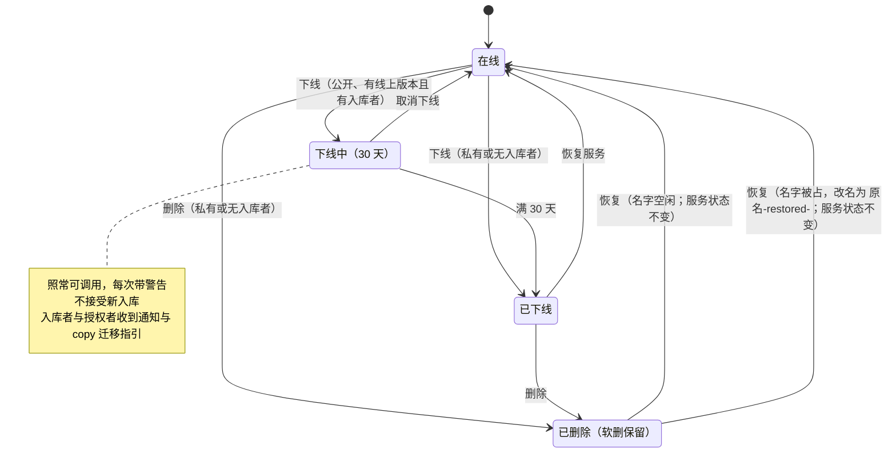

# v61-skill-deletion · 产品需求

> **最后更新**：2026-11-11
> **所属版本**：[`README.md`](README.md)

## 用户与场景

**谁在用**：

- **作者 A**：删过自己的 skill，想用同一个名字重新做一个。
- **作者 B**：要退场一个公开 skill，已经有人把它入库或获得授权。
- **调用方 C**：把某个公开 skill 编进了自己的服务或定时任务，需要提前知道它要消失，并有一条把依赖变成快照的路。

**在什么场景下用**：

- A 试验完删掉 `alice/pdf-tools`，三个月后想用同一个名字做另一件工具——今天会得到 `skill_deleted`，只能换名字。
- B 不再维护一个公开 skill，准备下线；它已经有若干入库者与授权者。
- C 收到下线中通知，用 `copy` 在自己的库里留一份，继续运行。

**现在的替代做法**：A 只能换名字，或恢复旧 skill 再覆盖版本（旧内容与历史仍留着）；B 只能直接下线或删除，再到别的渠道口头通知；C 没有任何平台内的预警或迁移入口。

## 生命周期



读法：

- **私有 skill（无论共享给谁）与没有入库者的公开 skill**：下线、删除都即时完成。
- **公开、有线上版本且有入库者**：下线先进「下线中」30 天；期间仍可调用、每次警告，但**不接受新入库**；满 30 天自动进入「已下线」，此时才允许删除。在线时点删除，先引导去下线。
- **已删除是软删**：数据保留，可从「已删除」列表恢复；原名已被新 skill 占用时，恢复改名为 `原名-restored-<id>`。

## 范围

### 做

| # | 做什么 | 交付形态 |
|---|---|---|
| 1 | 删除立即释放名字：同名可以创建、提交、复制；数据仍软删保留；恢复冲突时自动改名为 `原名-restored-<id>` | 服务端 + 控制台 + CLI |
| 2 | 删除确认显示影响面（授权人数、入库人数、是否公开）；删除后通知受影响的每一个人 | 服务端 + 控制台 + 通知 |
| 3 | 公开且曾发布（曾有上线版本）的 skill 删除后返回 410 + 原因；私有与从未发布的删除保持 404；已下线保持 503 `skill_offline` | 服务端 + CLI |
| 4 | 公开、有线上版本且有入库者的 skill：下线进入「下线中」30 天，期间照常可调用、每次调用带警告，但**不接受新入库**；到期自动转「已下线」；公域与信息页标「下线中」 | 服务端 + 设计稿 + 控制台 + CLI |
| 5 | 下线中的开始与结束都通知入库者与授权者，并给出 `copy` 迁移指引；取消下线回到在线并通知 | 服务端 + 通知 |
| 6 | 没有入库者的公开 skill、以及任何私有 skill：下线与删除即时生效；删除后通知入库者与授权者 | 服务端 + 控制台 + CLI |
| 7 | 入库时说明依赖契约：引用不复制、作者退场会通知并保留 30 天、要长期独立运行请 `copy` | 设计稿 + 控制台 + CLI |
| 8 | 文档、设计稿、服务端、控制台、CLI 与各层测试 | 全仓 |

### 不做

| # | 不做什么 | 为什么 | 什么时候可能做 |
|---|---|---|---|
| 1 | 真删 / 物理清除内容 | 用户明确要求系统层保留数据；删除仍是软删 | 隐私或合规提出清除要求时另开 ADR |
| 2 | 单独的「弃用」状态或动词 | 折进「下线中」，避免同一个状态机两个名字 | 不做 |
| 3 | 所有公开 skill 一律公告期 | 没有入库者时没有依赖方；npm 也只在这种情况下限制下架 | 不做 |
| 4 | 有入库者时禁止删除或要求运营审批 | 所有权优先；用通知与迁移保护调用方 | 未定 |
| 5 | 产品内提供「立即下线」通道 | 紧急情况由作者联系官方邮箱、平台后台处理；不在界面或 CLI 开放跳过 30 天的开关，避免它被当成常规退场 | 不做 |
| 6 | 把删除权限扩给 `admin` | [ADR 0047](../../decisions/0047-permissions-are-a-ladder.md) 明写删除是所有者独有的 | 未定 |
| 7 | 所有权转移 / 交接 | 独立产品面，超出本版范围 | 未定 |
| 8 | 已发布 skill 的 CLI 删除 | 高风险：删除改变「谁能看见 / 调用」，保留控制台由人确认（[ADR 0047](../../decisions/0047-permissions-are-a-ladder.md)、[ADR 0056](../../decisions/0056-dangerous-actions-are-confirmed-in-a-modal.md)） | 未定 |
| 9 | 版本级弃用 / 下线 | 本版只做 skill 级；版本已有下线、撤销与回滚 | 未定 |

## 控制台操作与 CLI 对应

| # | 控制台操作 | CLI 命令 | 备注 |
|---|---|---|---|
| 1 | 删除 skill（含影响面确认） | 从未上线：`skmr skill delete <地址> --yes`；已上线：只在控制台（公开但从未发布的 skill 仍可由凭据删除：它没服务过任何人） | 高风险例外（`profile.md` §控制台与 CLI） |
| 2 | 下线 / 取消下线 / 恢复服务 | `skmr skill offline <地址>` / `skmr skill online <地址>`（打开网页由人确认） | 现有页面动作，形状不变 |
| 3 | 恢复已删除的 skill | `skmr skill restore <地址>` | 恢复冲突时回执给出新地址 |
| 4 | 查看已删除的 skill | `skmr skills list --show deleted` | 已有 |
| 5 | 查看下线中状态与日期 | `skmr skills list --show pending` / `skmr skill show <地址>` | 新增 `pending` 筛选值；`offline` 仍指已下线 |
| 6 | 入库（依赖声明） | `skmr skill join <地址> --yes` | 文案补依赖契约；下线中拒绝入库 |
| 7 | 复制到我的库（迁移） | `skmr skill copy <地址> --name <新名字>` | 下线通知里给出 |

### CLI 输出（v61）

这一版不改命令的形状，改的是几处句子与一个筛选值。以下都是文本模式；`--json` 的字段由技术设计定。

**下线 / 恢复仍是页面动作**：`skmr skill offline` / `online` 只预检并打开设置页，由人在页面上确认。下线中时 `skmr skill online` 打开的就是取消下线那一页；`skmr skill offline` 在此时拒绝，并给出 `skmr skill online <地址>`（不会打开一个按钮与命令相反的页面）。CLI 不返回最终状态，事后用 `skmr skills list --show pending|offline` 或 `skmr skill show` 查。删除仍只对从未上线的 skill 由凭据执行，上线过的指向网页。

**调用方**

- `skmr skill invoke` 与 `skmr run` 在下线中仍成功，只在 stderr 加一行：
  ```
  dev/pdf-tools 正在下线中，将于 2026-12-11 正式下线。要保留它，复制到自己的库：skmr skill copy dev/pdf-tools --name <新名字>
  ```
- `skmr skill join` 在下线中被拒绝：
  ```
  这个 skill 正在下线中，将于 2026-12-11 正式下线，不能再入库。要保留它，复制到自己的库：skmr skill copy dev/pdf-tools --name <新名字>。
  ```
- 已下线仍是现有的 `503 skill_offline`：`这个 skill 已下线，暂时不提供服务。`

**作者**

- `skmr skill delete`（从未上线）成功后：
  ```
  已删除 dev/pdf-tools。名字已释放，可以用同一个名字新建；要找回这一条用 skmr skill restore dev/pdf-tools。
  ```
- `skmr skill delete`（上线过）仍只指向网页：
  ```
  这个 skill 上线过，不能由凭据删除；到网页上由人确认：<设置页地址>。如果它已公开、有线上版本且有入库者，先走完 30 天下线中，再删除。
  ```
- `skmr skill restore` 同名冲突时：
  ```
  已恢复。原名已被占用，这个 skill 现在叫 dev/pdf-tools-restored-<id>。
  ```
- `skmr skills list --show pending` 只看下线中；`--show offline` 仍是已下线；`--verbose` 的状态列写 `下线中 · 2026-12-11` 或 `已下线`。
- `skmr skill show` 的状态行同样带日期；`skmr skill online` 在下线中打开取消下线页，`skmr skill offline` 在下线中拒绝并指向 `online`。

## 验收与指标

### 验收标准

| # | 验收标准 | 怎么判定 |
|---|---|---|
| A1 | 删除 `ns/x` 后同一时刻用 `ns/x` 创建新 skill 成功；旧版本仍出现在「已删除」列表 | 集成测试：delete → create → 断言 201；列表断言旧条目仍在 |
| A2 | 同名新 skill 存在时恢复旧条目，恢复成功且地址为 `ns/x-restored-<id>`；版本、授权与可见性完整 | 集成测试：delete → create → restore → 断言地址与新地址下的版本/授权 |
| A3 | 删除一个已走完下线、曾有 2 个入库者与 1 个授权者的公开 skill 时，确认数据包含 2、1 与「公开」 | 接口测试断言影响面字段；控制台测试断言文案 |
| A4 | 该 skill 删除后，2 个入库者与 1 个授权者各收到一条通知 | 通知接口/表断言收件人数与类型 |
| A5 | 公开且曾发布的 skill 删除后地址返回 410 + 原因；私有与从未发布的 skill 删除后返回 404 | HTTP 断言状态码与错误体 |
| A6 | 公开、有线上版本且有入库者的 skill 点击下线后状态为「下线中」，到期时间 = 操作时刻 + 30 天（UTC） | 服务端用例断言状态与时间 |
| A7 | 下线中调用成功，输出包含下线日期；信息页与公域卡片显示「下线中」 | CLI 输出断言 + 控制台测试 |
| A8 | 下线中开始时入库者与授权者各收到通知，通知里包含 `skmr skill copy` 指引 | 通知断言 |
| A9 | 到期任务运行后状态为「已下线」，调用返回 503，入库者与授权者收到结束通知；此时删除允许 | 集成测试：推进时间 → 跑任务 → 断言状态、503 与通知 |
| A10 | 取消下线回到在线，警告消失，入库者与授权者收到取消通知 | 集成测试 + 通知断言 |
| A11 | 公开但无入库者、或私有 skill：下线与删除即时完成；删除后入库者与授权者收到通知 | 集成测试 |
| A12 | 创建 / 提交不再返回 `skill_deleted`；控制台与 CLI 文案不再写「名称不会被释放」 | 搜索断言 + CLI 输出测试 |
| A13 | 控制台新增或改动的每一处操作都在上表有命令或已记录例外 | 逐行核对映射表 |
| A14 | 下线中的 skill 不能入库：控制台不显示入库入口，`skmr skill join` 返回拒绝 | 控制台测试 + CLI 测试 |

**成立条件**：A1、A5、A6、A9 任一不过，本版不算交付。

### 指标

| 指标 | 定义 | 怎么量 | 目标 |
|---|---|---|---|
| 同名重建被拒次数 | 上线后 30 天内 `skill_deleted` 出现在创建 / 提交响应里的次数 | 服务端日志 / 审计 | 0 |
| 公开退场走完下线流程的比例 | 公开、有线上版本且有入库者的删除中，经过「已下线」的比例 | 状态 / 审计 | 100% |

## 依赖与前置

- **外部依赖**：无。
- **内部前提**：[ADR 0183](../../decisions/0183-deleting-a-skill-releases-its-name.md)（删除释放名字）、[ADR 0184](../../decisions/0184-taking-a-public-skill-down-is-a-service-lifecycle.md)（公开退场按服务生命周期）；`design/` 先改；通知模块与到期任务可复用现有结构。
- **排除了什么前置**：不需要先做「命名空间成员可写」——本版的名字释放只涉及个人命名空间；该能力落地时要重看防抢注论证（写进 ADR 0183 §后果）。
