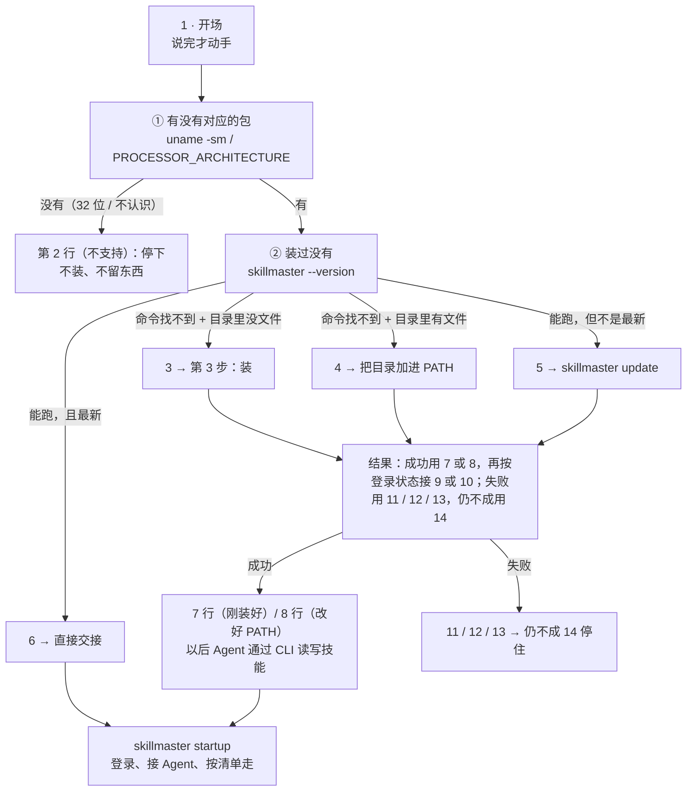

# 安装路径（给 agent 看的流程图）

> **这是什么**：`skillmaster-site/public/install/skillmaster.md` 的结构图——每一步用话术表的第几行、自己做什么、在哪儿停。
> **终点在哪**：**CLI 能跑就算装完**。装好之后交给 `skillmaster startup`，登录、接 Agent、清单都由它管；安装说明不替它开头。
> **权威在哪**：要说的每一句话以那份说明页的「话术定稿」表为准，这份只画流程；两者不一致时改这份。

## 一张图

## 每一步：用哪一行、自己做什么

| 步骤 | 用哪一行 | agent 做什么 | 停在哪 |
|---|---|---|---|
| **开场** | 1 | 说完**才**跑检查 | — |
| **① 有没有包** | 不支持 → 2 | `uname -sm`；Windows 看 `PROCESSOR_ARCHITEW6432` → `PROCESSOR_ARCHITECTURE` | **停**，不装、不留东西 |
| **② 装过没有** | 没装过 → 3／装过找不到 → 4／旧了 → 5／最新 → 6 | `skillmaster --version`；找不到时再看默认目录里有没有文件 | — |
| **装（没装过）** | 3 之后直接装 | 跑安装命令（不问、不播报） | 见附录 A |
| **改 PATH（装过找不到）** | 4 之后直接改 | 把默认目录加进 PATH，**新开终端** | 改不动用 14 停住 |
| **更新（旧了）** | 5 之后直接更新 | `skillmaster update` | 见附录 A |
| **刚装好 / 刚更新** | 7，然后 9 或 10 | 确认 `skillmaster --version` 打印出版本与提交号；`skillmaster auth status` 看登录 | 跑不起来 → 用 14 停住 |
| **改好 PATH，新开终端** | 8，然后 9 或 10 | 跑 `skillmaster startup` | 跑不起来 → 用 14 停住 |
| **本来就最新** | 6，然后 9 或 10；**不再说 7** | 直接跑 `skillmaster startup` | 这次什么都没装，不能说「装好了」 |
| **交接** | 6 / 7 / 8 挑一句开头，再按登录状态接 9（没登）或 10（已登） | 跑 `skillmaster startup`；不解释后面的步骤 | 交给旅程 |

## 两个平台不一样的地方

| | macOS / Linux | Windows |
|---|---|---|
| 安装目录 | `~/.local/bin` | `%LOCALAPPDATA%\SkillMaster\bin` |
| 架构 | `uname -m` | `PROCESSOR_ARCHITEW6432` → `PROCESSOR_ARCHITECTURE` |
| PATH 生效 | 新开终端 | 新开终端 |
| 安装脚本 | `install.sh` | `install.ps1` |

## 装失败时

**每次都要先说清：这次什么都没装成，你电脑上原来的东西没被动过。**

| 脚本说什么 | 用哪一行 | 接下来 |
|---|---|---|
| 下载失败 / `Connection reset by peer` / 连不上 | 11 | 换桶的地址重试一次，再失败用 14 停住 |
| `建不了安装目录` / `复制失败` | 12 | 换一个可写目录再装，仍失败用 14 |
| `校验和不符` | 13 | 重试一次，仍失败用 14 |

**不许为了让它「成功」绕开校验和、换来源，或把失败说成成功。**

## 三条不变的规则

1. **不问、不播报**：用户把「开始」那句发过来就是同意，装、更新、改位置之前不再问；过程中也不报「正在下载」。开场那句仍最先说。**`startup` 旅程同样照这条办**：清单里挑了哪几项就是同意了那几项，写说明、传技能、上线、备份都不再逐步请示；只有三处要问，且每处都带推荐——同名技能留哪份、文件里已有的写法换不换、本机那份清不清（清之前先备份）。
2. **停下要说清三件**：停在哪一步、什么都没变（原来的东西没被动过）、以后怎么继续。
3. **技术词不进口语**：路径、命令、`PATH`、TLS 都不出现在对用户说的话里。
